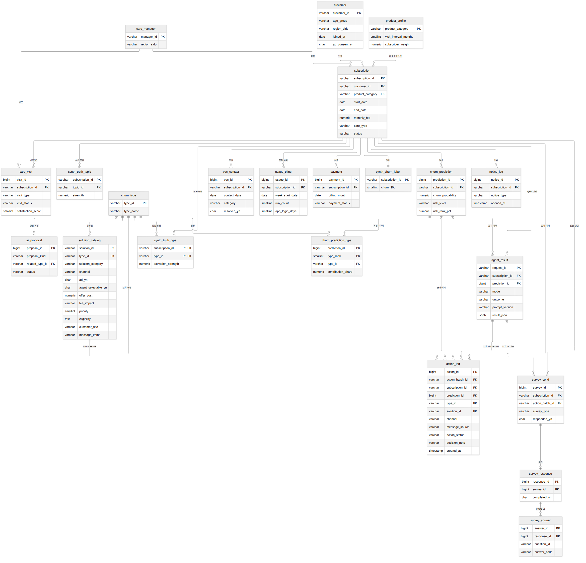

# 데이터 스키마 설계서 (v1.4 초안, 10유형 + 솔루션 확정 + Agent 구현 점검 반영)

> LG전자 AX School Build2 · 구독 이탈 예측 & 유형별 맞춤 방지 AI Agent
> 작성 기준일: 2026-10-01 (수정 2026-10-07: 이탈 유형 11개 → 10개(T01~T10) 개정, 솔루션 확정(알림톡 보고서 38건) 반영 / 최종 수정 2026-10-08: Agent 구현 점검 반영 — 고객용 제목·▶ 항목·결정 메모 컬럼, 설문 유형 `no_candidate`, 결정 이력 §11) / 짝 파일: `schema_postgres.sql` (DDL), `churn_types_10.md` (유형 정의)
> **솔루션 38건 확정**(2026-10-07, 출처 `유형확정_솔루션_합본_v3 1 1.xlsx`의 '유형요약'·'알림톡 보고서'). §7 매핑과 `solution_catalog`는 `solution_catalog_design.md`·`solution_catalog.json`·`seed_solution_catalog.sql`과 함께 봅니다.
> 모든 데이터는 **가설 기반 synthetic data**이며 실제 LG전자 데이터의 특성을 재현한 것이 아닙니다. 모델 성능은 "파이프라인 검증" 용도로만 해석합니다.
> 표기: `[팀 결정 필요]` / `[제안]` / `[가정]` / `[확정]`

---

## 1. 설계 원칙

| 원칙 | 내용 |
|---|---|
| 스코어링 단위 | **구독(subscription)**. MVP는 고객 1 : 구독 1이지만 스키마는 1:N 허용 `[확정]` |
| 기준일(as_of) | 기준일 단일 시점 스냅샷(시계열 없음, 예: 2026-09-30, 설정값). 피처는 기준일까지의 정보, 라벨은 기준일 이후 30일 내 이탈 여부. 이벤트 조회 기간(lookback)은 피처별 윈도우로 정의(§5 윈도우 규칙). 기본 최근 윈도우는 최대 180일, 방문·A/S는 365일 `[제안]` |
| 이탈 정의 | 기준일 다음날부터 30일 내 **해지 접수** `[확정]` |
| 누수 방지 | 스냅샷 시점 `subscription.status`는 전부 '활성'. 정답(label)·진짜 유형(truth)은 `synth_*` 테이블에 분리, 학습·추론 입력 금지 |
| 피처는 저장하지 않음 | 원천 테이블에서 `build_features(as_of)` 함수로 계산 (테이블에 피처 컬럼 중복 저장 안 함) |
| 이식성 | PostgreSQL 기준, VARCHAR+CHECK, CHAR(1) Y/N, 결측은 NULL. 정본은 CSV/Parquet + 멱등 적재 스크립트 |
| 조치 | 실제 발송 없이 `action_log`에 이력만 기록(시뮬레이션) `[확정]` |
| 외래키 | **DB 외래키 제약은 두지 않음** `[확정 2026-10-07]`. 합성 데이터를 자주 다시 만들고 고쳐서 적재 순서·수정 제약이 부담이 되기 때문. 이 문서의 `FK` 표기는 **논리 관계**이며, DDL 머리의 '논리 관계' 목록(29개)과 ERD가 같은 내용. 무결성은 ① 적재 후 `sql/check_integrity.sql`(부모 없는 행 수, 모두 0이어야 함) ② 앱 단 검사(`decide`·`forward`가 `agent_result` 존재를 확인)로 지킨다. PK·UNIQUE·NOT NULL·CHECK는 유지하고, 조인 컬럼 인덱스는 직접 둠(PostgreSQL은 FK를 만들어도 자식 쪽 인덱스를 자동 생성하지 않음) |

---

## 2. 테이블 목록과 우선순위

| 구분 | 테이블 | 역할 | 우선순위 |
|---|---|---|---|
| 참조 | `product_profile` | 6개 제품군별 기본값(요금대·계약·고장률·사용량·생성 비중) | Must |
| 참조 | `care_manager` | 케어 매니저 마스터 | Should |
| 참조 | `churn_type` | 10개 유형(T01~T10) + 유형 없음 마스터 | Must |
| 참조 | `solution_catalog` | LLM이 고를 수 있는 솔루션 화이트리스트 | Must |
| 핵심 | `customer` | 고객 | Must |
| 핵심 | `subscription` | 구독(스코어링 단위) | Must |
| 이벤트 | `usage_thinq` | 주 단위 사용·앱 접속 집계 | Must |
| 이벤트 | `care_visit` | 정기점검·A/S·설치 통합 | Must |
| 이벤트 | `voc_contact` | 상담·문의(15 카테고리) | Must |
| 이벤트 | `payment` | 월 청구·납부 | Must |
| 이벤트 | `notice_log` | 안내 발송·열람 이력 | Should (대안: subscription에 플래그 2개) |
| 결과 | `churn_prediction` | 전 구독 사전 계산 점수(목록 화면용) | Must |
| 결과 | `churn_prediction_type` | 예측 1건당 유형 1~3개 + 기여도 | Must |
| 결과 | `agent_result` | Agent 1회 실행 결과(상담자에게 보여 준 초안 포함, JSON) | Must |
| 결과 | `action_log` | 조치 시뮬레이션 이력(쿨다운 판정 기준) | Must |
| 설문 | `survey_send` · `survey_response` · `survey_answer` | 설문 발송·응답(long 형식, 응답은 시뮬레이터가 생성) | Must |
| 설문 | `ai_proposal` | 설문 집계를 본 AI의 신규 유형·솔루션 제안과 검토 상태 | Should |
| 합성 | `synth_churn_label` | 학습용 정답 | Must |
| 합성 | `synth_truth_type` | 검증용 정답 유형 | Must (검증용) |
| 합성 | `synth_truth_topic` | 검증용 정답 숨은 주제(설문 합성용) | Should (검증용) |

**대안 `[제안]`**: 일정이 빠듯하면 `notice_log`를 빼고 `subscription`에 `renewal_notice_sent_yn`, `renewal_notice_opened_yn` 2개 컬럼으로 대체합니다. T03의 "재계약 안내 접촉 횟수" 신호가 약해지는 것이 단점입니다.

---

## 3. 테이블 관계 (ER)



핵심 흐름: **Customer → Subscription → (Usage / Care / VOC / Payment / Notice) → 피처 → ML → churn_prediction(+type) → Rule Engine → solution_catalog 선택 → action_log**

---

## 4. 컬럼 명세

범례: **이탈 관련성** = 이 컬럼이 어떤 유형의 신호인지(해당 없음이면 `-`). **NULL** = 허용 여부. 생성 방법의 확률·분포 값은 모두 `[가정]`입니다.

### 4.1 참조 테이블

#### product_profile (6행)

| 컬럼 | 타입 | 예시 | 설명 | 생성 방법 | 이탈 관련성 | NULL |
|---|---|---|---|---|---|---|
| product_category | VARCHAR(20) PK | 의류관리기 | 제품군 | 고정 6개 | 컨텍스트 | N |
| contract_structure | VARCHAR(10) | 구독형 | 구독형/렌탈형 | 정수기만 렌탈형 `[가정]` | - | N |
| fee_min / fee_max | NUMERIC | 39,900 / 69,900 | 월 요금 범위 | 제품별 직접 입력 | T01 (요금 규모) | N |
| contract_months | SMALLINT | 60 | 계약기간(제품별 단일 값) | 의류관리기 60 / 건조기 72 / 냉장고 60 / 세탁기 72 / 에어컨 60 / 정수기 48 `[확정]` | T03 | N |
| care_included_default | CHAR(1) | Y | 케어 기본 포함 | 정수기 Y | 컨텍스트 | N |
| visit_interval_months | SMALLINT | 4 | 정기점검 주기 | 방문관리 제품만 | T06 | Y |
| base_fault_rate_monthly | NUMERIC(6,4) | 0.0100 | 월 고장 접수 확률 | 제품별 입력 | T09 | N |
| base_usage_per_week | NUMERIC(6,2) | 4.50 | 주당 가동 횟수 | 제품별 입력 | T04 | N |
| subscriber_weight | NUMERIC(5,4) | 0.2200 | 더미 생성 시 제품 비중 | 의류관리기 22.2%, 건조기 17.9%, 냉장고 17.3%, 세탁기 15.6%, 에어컨 15.0%, 정수기 12.0% (보고서 이용 경험 비율 기반, 아래 참고) | - | N |

#### care_manager

| 컬럼 | 타입 | 예시 | 설명 | 생성 방법 | 이탈 관련성 | NULL |
|---|---|---|---|---|---|---|
| manager_id | VARCHAR(10) PK | M001 | 담당자 ID | 순번 | T07 | N |
| manager_name | VARCHAR(50) | 김OO | 가상 이름 | Faker 한글 | - | N |
| region_sido | VARCHAR(20) | 서울 | 담당 지역 | 고객 지역 분포에 맞춤 | T02 | N |
| avg_rating | NUMERIC(3,2) | 3.8 | 담당 매니저 평균 평점 `[제안]` | N(3.9, 0.5)를 1~5로 자름. T07 활성 구독은 평점이 낮은 매니저에 우선 배정 `[가정]` | T07 | Y |
| active_yn | CHAR(1) | Y | 활동 여부 | 대부분 Y | - | N |

#### churn_type (10행 + '유형없음' pseudo-type 1행) / solution_catalog

| 컬럼 | 타입 | 예시 | 설명 | 생성 방법 | NULL |
|---|---|---|---|---|---|
| churn_type.type_id | VARCHAR(4) PK | T01 | 유형 ID(T01~T10, 유형 없음은 '유형없음') `[확정]` | `churn_types_10.md` 그대로 | N |
| churn_type.type_name / description | VARCHAR | 구독료 부담형 | 유형명·설명. 큰 틀 6개 분류는 두지 않음(평면 10개) `[확정]` | 고정 | description만 Y |
| solution_catalog.solution_id | VARCHAR(10) PK | S-T01-A | 솔루션 ID `[제안]`. 알림톡 보고서 순서대로 유형 안에서 A, B, … 부여. 만족도 조사 `S-NT-A` | 38건 확정 + `S-NT-A` 1건(`seed_solution_catalog.sql`) | N |
| solution_catalog.seq_no | SMALLINT | 1 | 알림톡 보고서의 솔루션 번호(1~38), `S-NT-A`는 0 | 고정 | N |
| solution_catalog.type_id | FK | T01 | 대상 유형 | 고정 | N |
| solution_catalog.solution_category | VARCHAR(10) | 정보제공 | 정보제공/담당자조치/혜택제안/제품조치, `S-NT-A`만 의견수집 `[제안]` | `solution_catalog_design.md` D6 기준 배정 | N |
| solution_catalog.solution_name / solution_detail | VARCHAR | 구독 vs 구매 총비용 비교 카드 | 이름(알림톡 보고서 그대로)·상세 | 알림톡 보고서·설계 | detail만 Y |
| solution_catalog.channel | VARCHAR(10) | 알림톡 | 주 채널: 알림톡/친구톡/내부 전달/상담·앱 | 알림톡 보고서 | N |
| solution_catalog.ad_yn | CHAR(1) | N | 광고성(친구톡). Y면 `(광고)` 표기, `customer.ad_consent_yn='Y'`인 고객만 발송 `[제안]` | 친구톡 6건이 Y | N |
| solution_catalog.internal_forward_yn / forward_dept | CHAR(1) / VARCHAR | Y / 케어서비스운영팀 | 담당 부서 전달 동반 여부와 부서 | 내부 전달 12건(복합 5건 포함) | forward_dept만 Y |
| solution_catalog.delivery_kind | VARCHAR(10) | 고객 메시지 | 고객 메시지 / 내부 전달 / 상담·앱 안내 / 전사 개선 | 30 / 4 / 1 / 3건 | N |
| solution_catalog.agent_selectable_yn | CHAR(1) | Y | 'N' = 전사 개선(집계 리포트), 구독자 단위 후보 아님. 3건 | 고정 | N |
| solution_catalog.offer_cost | NUMERIC | 20,000 | 오퍼 비용: 무료 서비스 범위를 넘어 회사가 추가로 부담하는 금액(총액 상한 판정용) | 3건만 금액 `[가정]`(`S-T01-E` 20,000, `S-T06-D`·`S-T07-C` 5,000), 나머지 0. 0보다 큰 솔루션만 비용 상한 대상 | N |
| solution_catalog.fee_impact | VARCHAR(10) | 감소 | 고객 월 요금 변동 방향(없음/증가/감소) `[제안]` | `S-T01-C`·`S-T01-D`가 감소 | N |
| solution_catalog.trigger_note / buttons | VARCHAR | 만기 124일 전 / [4가지 비교하기] / [상담 연결] | 권장 발송 시점(Agent는 판정하지 않음)·알림톡 버튼 | 알림톡 보고서 | Y |
| solution_catalog.message_hint | VARCHAR(300) | "금액·날짜를 나란히 안내" | LLM 메시지(또는 내부 전달서) 작성 참고 | 직접 작성 (월 요금만 강조 금지 규칙 반영) | Y |
| solution_catalog.customer_title | VARCHAR(60) | 고객님, 프로모션 종료 후 구독료가 바뀌어요 | 고객용 제목(알림톡 보고서 제목을 일반화). 광고성이면 `(광고)`로 시작. 템플릿의 첫 문장으로도 씀 `[제안]`(2026-10-08) | `scripts/build_catalog.py` | Y(내부 전달·전사 개선) |
| solution_catalog.message_items | VARCHAR(300) | ["monthly_fee","promo_end_date"] | 고객 메시지의 ▶ 항목으로 보여 줄 고객 공개 값 키(JSON 배열, `agent/facts.py`의 `MESSAGE_FACT_DEFS`) `[제안]`(2026-10-08) | 같은 스크립트 | Y |
| solution_catalog.new_policy_yn | CHAR(1) | N | 현행 정책이 아닌 '신규 정책' 제안 | 4건이 Y | N |
| solution_catalog.priority | SMALLINT | 10 | Rule Engine 정렬 순서(작을수록 먼저). 10 직접 해결, 20 정보 안내, 30 광고·혜택, 40 내부 보고, 50 유형 없음, 90 전사 개선 `[제안]` | `solution_catalog_design.md` §4 표 | N |
| solution_catalog.eligibility | TEXT(JSON) | [["unapplied_discount_yn","==","Y","required"]] | 후보 자격 조건 `[fact, op, value(, "required")]`, 조건은 AND. 입력 `facts`에 값이 없으면 통과하되, 4번째 값이 `"required"`(사건이 있었다고 말하는 조건)면 후보 제외 `[제안]`(2026-10-08, `rules.unknown_required_fact`로 해제 가능) | 같은 문서 §4 | Y(NULL=항상 후보) |
| solution_catalog.active_yn | CHAR(1) | Y | 사용 여부 | Y | N |

### 4.2 핵심 테이블

#### customer

| 컬럼 | 타입 | 예시 | 설명 | 생성 방법 | 이탈 관련성 | NULL |
|---|---|---|---|---|---|---|
| customer_id | VARCHAR(10) PK | C000001 | 고객 ID | 순번 | - | N |
| customer_name | VARCHAR(50) | 박OO | 가상 이름 | Faker | - | N |
| age_group | VARCHAR(10) | 40대 | 연령대 | 20대 12 / 30대 28 / 40대 30 / 50대 20 / 60대+ 10 (%) | 컨텍스트 | N |
| region_sido | VARCHAR(20) | 경기 | 거주 시도 | 인구 비례 | T02 | N |
| joined_at | DATE | 2024-03-15 | 최초 가입일 | 구독 start_date 이전 | 컨텍스트 | N |
| thinq_app_installed | CHAR(1) | Y | 앱 설치 여부 | 85% Y | 컨텍스트(피처 미사용) | N |
| notify_consent_yn | CHAR(1) | Y | 알림톡·문자 수신 동의(구 `push_consent_yn`, 현업 의견상 채널이 푸시가 아니라 알림톡이라 이름 변경) `[제안]` | 80% Y | 컨텍스트(피처 미사용, 알림톡 수신 동의로 Agent 입력에 사용 가능) | N |
| ad_consent_yn | CHAR(1) | N | 카카오 채널 친구 + 광고 수신 동의. 친구톡(광고성) 솔루션 발송 조건 `[제안]` | 50% Y `[가정]`(시뮬레이션 민감도는 `agent_design.md` §4.7) | 컨텍스트(피처 아님) | N |
| weekday_daytime_available_yn | CHAR(1) | N | 평일 낮 방문 가능 여부 `[제안]` | 70% Y, T06 활성 시 N 확률 상승 | T06 | N |

#### subscription

| 컬럼 | 타입 | 예시 | 설명 | 생성 방법 | 이탈 관련성 | NULL |
|---|---|---|---|---|---|---|
| subscription_id | VARCHAR(12) PK | S000001 | 구독 ID | 순번 | - | N |
| customer_id | FK | C000001 | 고객 | 1:1 (MVP) | - | N |
| product_category | FK | 건조기 | 제품군 | product_profile.subscriber_weight 비율 | 컨텍스트 | N |
| model_name | VARCHAR(40) | DRY-A01 | 모델명 | 제품별 3~5개 모델 풀 | T03 | N |
| model_discontinued_yn | CHAR(1) | N | 단종 모델 여부 | 모델 풀 중 일부만 단종, T03 활성 시 단종 모델 우선 | T03 | N |
| new_model_released_yn | CHAR(1) | Y | 후속 신모델 출시 여부 `[제안]` | 모델 풀 중 일부 Y, T03 활성 시 Y 확률 상승 | T03 | N |
| start_date | DATE | 2024-06-01 | 구독 시작일 | 기준일 기준 1~72개월 전, 균등 | T02(초반)·T03 | N |
| contract_months | SMALLINT | 60 | 계약기간 | product_profile의 제품별 계약기간 | T03 | N |
| mandatory_months | SMALLINT | 36 | 의무사용기간 | contract_months 이하 (정수기는 =계약기간) | T02 | N |
| end_date | DATE | 2029-06-01 | 만료일 | start + contract_months | T03 | N |
| monthly_fee | NUMERIC | 59,900 | 월 요금 | fee_min~fee_max 정규분포 | T01 | N |
| discount_eligible_yn | CHAR(1) | Y | 결합·선납·제휴카드 등 할인 대상 여부 `[제안]` | 25% Y | T01(미적용 할인 신호) | N |
| discount_applied_yn | CHAR(1) | N | 할인 실제 적용 여부 `[제안]` | 대상자 중 정상군 80% Y, T01 활성 시 적용 확률 하락(미적용 = 대상 Y & 적용 N) | T01 | N |
| care_type | VARCHAR(10) | 방문관리 | 케어 유형 | 방문관리 37 / 자가관리 41 / 없음 22 (%) (보고서: 케어 동반 77.6% 중 방문관리 47.4%·자가관리 52.6% → 전체 대비 방문관리 36.8%, 자가관리 40.8%, 케어 없음 22.4%) | T05·T06(방문관리만 해당) · 컨텍스트 | N |
| care_auto_renew_yn | CHAR(1) | Y | 케어 자동갱신 | 케어 있으면 90% Y | 피처 아님. `S-T02-A`(해지 시 잔여 청구 사전 고지)의 자동 연장 안내에 사용 | N |
| care_renewal_date | DATE | 2026-11-20 | 케어 자동갱신일 | 케어 시작일 + 1년 단위 | 피처 아님. `S-T02-A` 고지의 자동 연장일에 사용(Agent 입력에 포함) | Y(케어 없음) |
| promo_discount_amount | NUMERIC | 10,000 | 프로모션 월 할인액 | 40% 구독이 보유 | T01 | N |
| promo_end_date | DATE | 2026-10-31 | 프로모션 종료일 | 시작 후 6~24개월 | T01 | Y |
| care_manager_id | FK | M012 | 담당자 | 방문관리만 배정 | T07 | Y |
| manager_change_confirmed_yn | CHAR(1) | N | 담당 매니저 교체 확정 여부 `[제안]` | 대부분 N | T07 (S-T07-D 트리거) | N |
| status | VARCHAR(10) | 활성 | 상태 | 스냅샷 시점 전부 '활성' | 누수 방지 | N |

### 4.3 이벤트 테이블

#### usage_thinq (구독당 약 26행 = 26주)

| 컬럼 | 타입 | 예시 | 설명 | 생성 방법 | 이탈 관련성 | NULL |
|---|---|---|---|---|---|---|
| usage_id | BIGINT PK | 1 | 자동 증가 | IDENTITY | - | N |
| subscription_id | FK | S000001 | 구독 | - | - | N |
| week_start_date | DATE | 2026-09-21 | 주 시작일(월) | 기준일 역산 26주 | - | N |
| run_count | SMALLINT | 4 | 주간 가동 횟수 | base_usage_per_week 주변 푸아송, T04 활성 시 후반부 지수 감소 | T04 | N |
| run_minutes | INTEGER | 210 | 주간 가동 분 | run_count × 제품별 평균 시간 | T04 | N |
| app_login_days | SMALLINT(0~7) | 3 | 앱 접속 일수 | 앱 미설치자 0, T04 활성 시 후반부 감소 | T04 | N |

#### care_visit

| 컬럼 | 타입 | 예시 | 설명 | 생성 방법 | 이탈 관련성 | NULL |
|---|---|---|---|---|---|---|
| visit_id | BIGINT PK | 1 | 자동 증가 | IDENTITY | - | N |
| subscription_id | FK | S000001 | 구독 | - | - | N |
| manager_id | FK | M012 | 방문 담당자 | 구독의 담당자. T07 활성 시 365일 내 1~3회 교체 | T07 | Y |
| visit_type | VARCHAR(10) | 정기점검 | 정기점검/AS수리/이전설치/최초설치 | 정기점검: visit_interval_months마다, AS수리: 월 고장 확률, 이전설치: T02 활성 시 | T06·T09·T02·T05(케어 후 14일 내 A/S) | N |
| scheduled_date | DATE | 2026-08-10 | 예정일 | 기준일 이전 365일 내, visit_interval_months 주기 기반(정수기 4개월 ≈ 3건, 대형가전 12개월 ≈ 1건) | - | N |
| completed_date | DATE | 2026-08-18 | 완료일 | 지연완료는 예정일+3~20일 | T06 | Y |
| visit_status | VARCHAR(10) | 지연완료 | 완료/지연완료/취소/미이행/예정 | T06 활성 시 지연·취소·미이행 비율 상승 | T06 | N |
| reschedule_cnt | SMALLINT | 2 | 일정 변경 횟수 | T06 활성 시 증가 | T06 | N |
| duration_min | SMALLINT | 38 | 방문 소요시간(분), 케어 방문 `[제안]` | 기준 45분 `[가정]`, T05 활성 시 강도에 따라 20~50% 단축 | T05 | Y(케어 방문 외) |
| booking_lead_days | SMALLINT | 21 | 예약 접수~방문 예정일 대기일 `[제안]` | 평균 7일, T06 활성 시 14~35일 | T06 | Y |
| sales_pitch_yn | CHAR(1) | N | 방문 중 영업 권유 여부 `[제안]` | 정상군 3%, T08 활성 시 방문의 30~80% Y | T08 | N |
| repitch_after_refusal_yn | CHAR(1) | N | 거절 후 재권유 여부 `[제안]` | sales_pitch_yn=Y 방문 중 정상군 10%, T08 활성 시 강도 비례 | T08 | N |
| split_as_receipt_yn | CHAR(1) | N | A/S가 나뉘어 접수됨 `[제안]` | AS수리 중 정상군 5%, T10 활성 시 20~70% Y | T10 | N |
| symptom_code | VARCHAR(10) | SYM03 | 증상 코드(의미는 아래 증상 코드표) | AS수리일 때만. 코드는 12개 중 균등 추출, T09 활성 시 동일 코드 반복 | T09 | Y |
| repeat_symptom_yn | CHAR(1) | Y | 90일 내 동일 증상 반복 | T09 활성 시 Y | T09 | N |
| parts_delay_yn | CHAR(1) | Y | 부품 수급 지연 | T10 활성 시 Y | T10 | N |
| repair_days | SMALLINT | 14 | 접수~수리 소요일 | 평균 3일, T10 활성 시 10~30일 | T10 | Y(AS수리 외) |
| inspection_anomaly_yn | CHAR(1) | N | 정기점검 중 이상 감지 `[제안]` | 대부분 N | T09 (S-T09-C 트리거) | N |
| as_received_date | DATE | 2026-09-28 | A/S 접수일, AS수리만 `[제안]` | 예정 방문의 접수일 | T10 (S-T10-D 트리거) | Y(AS수리 외) |
| expected_complete_date | DATE | 2026-10-07 | A/S 예상 완료일, AS수리만. 예상 수리 기간 = 완료일 - 접수일 `[제안]` | 접수일 + 1~14일 | T10 (S-T10-D 트리거) | Y(AS수리 외) |
| satisfaction_score | SMALLINT(1~5) | 2 | 방문 만족도 | 응답률 60%, T07 활성 시 하향 | T07 | Y(미응답) |


**증상 코드표 (`symptom_code`) `[제안]`** — 코드 값은 지금까지 생성 데이터와 같고, 생성기는 바꾸지 않았습니다(코드 추출은 균등). 의미는 설문 합성(`fail` 심화 문항 A)을 위해 붙였습니다. 이탈 유형 모델과 솔루션 조건은 "같은 코드인지"만 보므로 영향이 없습니다.

| 코드 | 증상 | 설문 묶음 |
|---|---|---|
| SYM01 | 작동 중 큰 소음 | noise |
| SYM02 | 진동·덜컹거림 | noise |
| SYM03 | 펌프·모터 이상음 | noise |
| SYM04 | 팬·압축기 소음 | noise |
| SYM05 | 냉각·온수·세척 성능 저하 | perf |
| SYM06 | 출수량·풍량 감소 | perf |
| SYM07 | 작동 시간 증가·동작 느림 | perf |
| SYM08 | 냄새·수질·건조 상태 이상 | perf |
| SYM09 | 전원 켜짐 불량 | broken |
| SYM10 | 누수 | broken |
| SYM11 | 표시창·센서 오류 | broken |
| SYM12 | 작동 정지 | broken |

#### voc_contact

| 컬럼 | 타입 | 예시 | 설명 | 생성 방법 | 이탈 관련성 | NULL |
|---|---|---|---|---|---|---|
| voc_id | BIGINT PK | 1 | 자동 증가 | IDENTITY | - | N |
| subscription_id | FK | S000001 | 구독 | - | - | N |
| contact_date | DATE | 2026-09-12 | 접수일 | 기준일 이전 180일 내 생성(상담 피처 윈도우는 90일) | - | N |
| channel | VARCHAR(10) | 앱 | 앱/전화/챗봇 | 앱 45 / 전화 40 / 챗봇 15 (%) | - | N |
| category | VARCHAR(20) | 위약금문의 | 15개 카테고리(요금·총비용·위약금·해지·이사·갱신·일정변경요청·재방문요청·케어결과불만·담당자교체요청·태도불만·영업불만·응대불만·사용법·기타) | 정상군: 기타·사용법·요금 소량, 활성 유형별 카테고리 비중 상승 (§6 매트릭스) | 유형별 | N |
| repeat_contact_yn | CHAR(1) | Y | 동일 카테고리 14일 내 재문의 | 생성 후 계산 | T10 | N |
| resolved_yn | CHAR(1) | N | 해결 여부 | 정상 90% Y, T10 활성 시 50% | T10 | N |
| first_response_unresolved_yn | CHAR(1) | Y | 1차 응대에서 해결되지 않음 `[제안]` | 정상 10%, T10 활성 시 40~80% Y | T10 | N |
| cancel_delay_days | SMALLINT | 6 | 해지문의 접수~처리 지연일 `[제안]` | 해지문의에만 값. 정상 0~2일, T02 활성 시 2~10일 | T02 | Y(해지문의 외) |
| response_hours | NUMERIC(6,1) | 26.5 | 최초 응답 시간 | 로그정규, T10 활성 시 증가 | T10 | Y |
| sentiment_score | NUMERIC(3,2) | -0.40 | 감성 점수(선택) | 불만 카테고리일수록 음수 | -(보조) | Y |
| summary_text | VARCHAR(500) | "위약금이 얼마인지 문의" | 가상 문의 요약(선택, LLM 생성 가능) | 템플릿 또는 LLM | Agent 근거 문장 | Y |

#### payment (구독당 약 6행 = 6개월)

| 컬럼 | 타입 | 예시 | 설명 | 생성 방법 | 이탈 관련성 | NULL |
|---|---|---|---|---|---|---|
| payment_id | BIGINT PK | 1 | 자동 증가 | IDENTITY | - | N |
| subscription_id | FK | S000001 | 구독 | - | - | N |
| billing_month | DATE | 2026-09-01 | 청구월 | UNIQUE(구독, 월) | - | N |
| billed_amount | NUMERIC | 69,900 | 청구액 | monthly_fee 기반, 프로모션 종료 후 상승, T01 활성 시 중간 인상 | T01 | N |
| discount_amount | NUMERIC | 0 | 할인액 | promo 기간 중 promo_discount_amount | T01 | N |
| paid_amount | NUMERIC | 69,900 | 납부액 | 정상 시 청구−할인, 미납이면 NULL | T01 | Y |
| due_date | DATE | 2026-09-25 | 납기일 | 매월 25일 | - | N |
| paid_date | DATE | 2026-09-24 | 납부일 | 정상은 납기 내, 연체는 납기 후 | T01 | Y |
| payment_status | VARCHAR(10) | 정상 | 정상/연체/미납 | 정상군 연체 3%, T01 활성 시 15% | T01 | N |

#### notice_log

| 컬럼 | 타입 | 예시 | 설명 | 생성 방법 | 이탈 관련성 | NULL |
|---|---|---|---|---|---|---|
| notice_id | BIGINT PK | 1 | 자동 증가 | IDENTITY | - | N |
| subscription_id | FK | S000001 | 구독 | - | - | N |
| notice_type | VARCHAR(10) | 갱신안내 | 갱신안내/사용팁/계약조건안내 (구 자동갱신고지·등록비안내는 유형 6 삭제로 제외) | 만료 D-90 갱신안내, T03 활성 시 D-60·D-30 추가 발송(재계약 안내 접촉 횟수 증가) | T03 | N |
| sent_at | TIMESTAMP | 2026-09-01 10:00 | 발송 시각 | 규칙 기반 | - | N |
| opened_at | TIMESTAMP | NULL | 열람 시각 | 정상군 열람률 60%, T03 활성 시 갱신안내 열람 Y | T03 | Y(미열람) |

### 4.4 예측·조치 결과 테이블

#### churn_prediction

| 컬럼 | 타입 | 예시 | 설명 | 생성 방법 | NULL |
|---|---|---|---|---|---|
| prediction_id | BIGINT PK | 1 | 자동 증가 | IDENTITY | N |
| subscription_id | FK | S000001 | 구독 | 전 구독 배치 점수화 | N |
| as_of_date | DATE | 2026-09-30 | 기준일 | 설정값 | N |
| churn_probability | NUMERIC(5,4) | 0.7420 | 30일 내 해지 접수 확률 | 이진 분류 모델 출력 (초기 MVP는 mock) | N |
| risk_level | VARCHAR(4) | HIGH | 상위 ~10% HIGH / 다음 ~10% MID / 나머지 LOW (순위 기준) `[제안]` | 모델 학습 후 점수 분포를 보고 컷오프 확정. 초기 mock은 ≥0.70 / 0.40~0.69 / <0.40 | N |
| risk_rank_pct | NUMERIC(6,5) | 0.04000 | 같은 기준일·모델버전 안에서 위험 순위 백분위(0 = 가장 높음). `risk_level`과 같은 시점에 배치로 계산해 저장 `[확정 2026-10-07]` | 점수 내림차순 `percent_rank()` | N |
| model_version | VARCHAR(20) | v0-mock | 모델 버전 | 문자열 | N |
| created_at | TIMESTAMP | now | 생성 시각 | DEFAULT | N |

인덱스: `(기준일, 모델버전, risk_rank_pct)`로 목록 정렬. 조회 때 계산하지 않고 저장하는 이유는 성능이 아니라 일관성입니다(3만 건은 어느 쪽이든 빠름). 등급(상위 10%=HIGH 등)이 순위에서 나오므로 같은 시점에 확정해야 어긋나지 않습니다.

#### churn_prediction_type

| 컬럼 | 타입 | 예시 | 설명 | 생성 방법 | NULL |
|---|---|---|---|---|---|
| prediction_id | FK, PK | 1 | 예측 | - | N |
| type_rank | SMALLINT(1~3) PK | 1 | 기여도 순위 | 기여도 내림차순 | N |
| type_id | FK | T02 | 이탈 유형 | SHAP 양수 그룹 비중 ≥ 20% 그리고 그룹 SHAP ≥ 0.5(로그오즈) `[가정]`인 유형, 최대 3개. 해당 없으면 '유형 없음'(행 없음 또는 pseudo-type) | N |
| contribution_share | NUMERIC(5,4) | 0.4100 | 해당 유형 기여 비중 | 양수 그룹 SHAP 합 ÷ 양수 그룹 전체 합 | N |
| top_features_json | TEXT | `[{"feature":"voc_penalty_cnt_90d","value":4,"shap":0.18}]` | 근거 피처 상위 N개 (Agent 근거 문장 재료) | SHAP 상위 3~5개 | Y |

#### agent_result `[확정 2026-10-07]`

| 컬럼 | 타입 | 예시 | 설명 | NULL |
|---|---|---|---|---|
| request_id | VARCHAR(20) PK | REQ-3fa9c21b07d4 | API가 만드는 요청 ID(20자 이내). `action_log.action_batch_id`가 참조 | N |
| subscription_id / prediction_id | FK | S000101 / 1 | 대상 구독·근거 예측 | N / Y |
| as_of_date | DATE | 2026-09-30 | 기준일 | N |
| mode / outcome / fallback | VARCHAR | ACTION / pass / NO_ELIGIBLE_CANDIDATE | 호출 경로, 검증·폴백 결과, 만족도 조사로 대체됐는지 | N / N / Y |
| attempts / failed_checks | SMALLINT / VARCHAR | 2 / M3,E3 | LLM 시도 횟수와 실패한 규칙 번호 | N / Y |
| llm_provider / llm_model / prompt_version | VARCHAR | openai / (모델명) / v3.0 | 어떤 모델·프롬프트로 만들었는지(평가·비교용) | Y |
| result_json | JSONB | {…} | AgentResult 전체(선택 항목, 합친 메시지, 협업 전달 초안, 분석) | N |

저장하는 이유: 서버를 재시작해도 상담자의 결정이 이어지고, LLM은 다시 부르면 문구가 달라져 초안을 복원할 수 없으며, AI 초안과 상담자 수정본(`memo_edited_yn`)을 비교해 프롬프트·모델을 평가하기 위해서입니다. 호출별 로그 테이블(`agent_llm_log`)은 만들지 않고, 토큰 비용 추적이 필요해지면 추가합니다 `[제안]`.

#### action_log

| 컬럼 | 타입 | 예시 | 설명 | 생성 방법 | NULL |
|---|---|---|---|---|---|
| action_id | BIGINT PK | 1 | 자동 증가 | IDENTITY | N |
| action_batch_id | VARCHAR(20) FK | REQ-3fa9c21b07d4 | 조치가 나온 Agent 요청(`agent_result.request_id`) | Agent 실행 시 생성 | N |
| subscription_id / prediction_id | FK | S000001 / 1 | 대상 구독·근거 예측 | - | N / Y |
| type_id / solution_id | FK | T02 / S-T02-A | 유형·솔루션 | Agent가 solution_catalog에서 선택 | N |
| action_category | VARCHAR(10) | 정보제공 | 조치 구분 | solution_catalog에서 복사 | N |
| title | VARCHAR(100) | "(광고) 놓친 할인 점검" | 알림톡·친구톡 제목. 광고성이면 `(광고)`로 시작 | Agent | Y |
| message_text | VARCHAR(1000) | "고객님, …\n▶ 현재 월 구독료: 36,000원" | 발송한 고객 안내 문구(LLM 또는 템플릿, 보고서 형식 400자 이내) | Agent | Y |
| internal_memo | VARCHAR(1000) | "케어 미완료 건 확인 요청" | 내부 전달서 본문(`internal_forward_yn='Y'`인 솔루션) | Agent | Y |
| message_source | VARCHAR(10) | llm | llm / template(폴백) | Agent | Y |
| decision_note | VARCHAR(300) | "고객이 이미 해지 접수" | 상담자 메모(반려 사유 등) `[제안]`(2026-10-08) | 확정/반려 시 입력 | Y |
| offer_cost | NUMERIC | 0 | 해당 조치 오퍼 비용 | solution_catalog에서 복사 | N |
| risk_prob_at_action | NUMERIC(5,4) | 0.7420 | 조치 시점 이탈 확률 | 예측 시점 값 | Y |
| action_status | VARCHAR(10) | 조치완료 | 제안됨/조치완료/반려. 반려는 쿨다운·비용 누계에 세지 않음. 코드는 조치완료·반려만 기록(제안 단계는 `agent_result`), '제안됨'은 DDL 기본값으로만 남음 | 상담자가 [발송하기]·[전달하기]를 누르면 '조치완료', 반려하면 '반려' | N |
| forward_depts | VARCHAR(100) | CS,PRICING | 내부 전달 수신 부서 코드(쉼표). 부서 마스터는 `churn_agent/data/departments.json` | 상담자가 협업 부서 전달 화면에서 선택 | Y |
| memo_edited_yn | CHAR(1) | N | 상담자가 AI 초안을 고쳐서 전달했는지 | 전달 시 초안과 비교 | N |
| channel | VARCHAR(10) | 알림톡 | 알림톡/친구톡/내부 전달/상담·앱 | solution_catalog에서 복사 | N |
| created_at / created_by / completed_at | TIMESTAMP / VARCHAR | - | 이력 메타. `created_at`은 기본으로 '기준일 + 현재 시각'(시뮬레이션 시계, `clock: simulated`), `completed_at`은 현재 코드에서 기록하지 않음 | 앱에서 기록 | Y(created_by, completed_at) |

### 4.4-1 설문·AI 제안 테이블 `[제안]` (2026-10-07 추가, DDL은 `schema_postgres.sql` 4-1)

설문 응답은 시뮬레이터가 만들지만(`survey_simulator_design.md`) 실제 응답이 들어와도 같은 구조를 씁니다. 응답을 파일로만 두지 않고 테이블에 적재하는 이유는 유형별 히트맵, 조치 효과(`action_log`와 연결) 같은 집계가 구독·예측·조치와 조인되기 때문이며, **집계 결과 테이블은 따로 두지 않고** `survey_answer`를 뷰·쿼리로 집계합니다(원본과 어긋나는 것을 막기 위해).

| 테이블 | 핵심 컬럼 | 설명 |
|---|---|---|
| `survey_send` | survey_id, subscription_id, action_batch_id(조치 후 설문이면), survey_type(post_action·post_churn·no_type·no_candidate·survey_only. `no_candidate`는 유형은 있으나 후보 0건이라 만족도 조사로 대체된 경우, 2026-10-08), sent_at, sent_by, responded_yn | 발송 이력 |
| `survey_response` | response_id, survey_id(UNIQUE), completed_yn, status_code, submitted_at | 응답 1건 = 1행 |
| `survey_answer` | response_id, question_id, answer_code, other_text | long 형식(복수 선택은 여러 행, 주관식은 other_text). 문항이 바뀌어도 테이블은 그대로 |
| `ai_proposal` | proposal_kind(new_type·new_solution), related_type_id, title, description, evidence_json, status(검토중·채택·기각), reviewed_by | AI가 설문 집계를 보고 낸 신규 유형·솔루션 제안. 사람이 검토해 채택하면 이력이 남음. 앞서 계획한 `churn_type_candidate`를 이 테이블로 대체 |
| `synth_truth_topic` | subscription_id, topic_id, strength | 숨은 주제 정답(검증 전용, 학습·추론 입력 금지) |

### 4.5 합성 정답 테이블

| 테이블 | 컬럼 | 설명 | 용도 |
|---|---|---|---|
| synth_churn_label | subscription_id PK, as_of_date, churn_30d(0/1), cancel_requested_date | 30일 내 해지 접수 여부와 날짜(이탈 시 기준일+1~30일) | **학습 정답** |
| synth_truth_type | subscription_id, type_id, activation_strength(0~1), is_primary_yn | 생성 시 활성화한 유형과 강도 | **검증 전용**: SHAP 유형 복원율 확인. 학습·추론 입력 금지 |

주의: 유형 신호를 직접 심어 생성하므로 유형 복원 검증은 순환적입니다. "파이프라인이 작동하는가"를 확인하는 용도이며 실제 성능 근거가 아닙니다.

---

## 5. 피처 정의 (build_features, 유형 그룹 68개 + 컨텍스트 5개) `[제안]`

SHAP 그룹화를 위해 피처마다 **소속 유형 그룹 1개**를 지정합니다. 컨텍스트 피처는 어떤 유형에도 귀속하지 않고 기여도 계산에서 제외(또는 별도 그룹)합니다. 10유형 개정(2026-10-07)으로 이전 61개에서 **13개 삭제(구 4-1 6개, 구 6 7개), 20개 추가**해 68개가 되었습니다(이전 문서의 "60개"는 61개의 오기). 굵게 표시한 피처가 **신규 신호**입니다.

| 유형 그룹 | 피처 (기간은 as_of 기준) | 원천 |
|---|---|---|
| **T01** 구독료 부담 | voc_fee_cnt_90d, voc_totalcost_cnt_90d, promo_days_to_end, billed_change_rate_3m, late_payment_cnt_6m, discount_ratio, **unapplied_discount_yn**(할인 대상인데 미적용) | voc, subscription, payment |
| **T02** 해지·이사 장벽 | voc_penalty_cnt_90d, voc_cancel_cnt_90d, months_since_start, penalty_zone(1~3년차), early_stage_penalty_voc_flag, voc_move_cnt_90d, relocation_install_requested_yn, relocation_install_delay_days, region_changed_flag, **cancel_processing_delay_days**(해지 접수 처리 지연일) | voc, subscription, care_visit |
| **T03** 재계약·갈아타기 갈등 | days_to_end, renewal_notice_sent_yn, renewal_notice_opened_yn, voc_renewal_cnt_90d, model_discontinued_yn, **new_model_released_yn**, **renewal_notice_contact_cnt**(재계약 안내 접촉 횟수) | subscription, notice, voc |
| **T04** 사용 빈도 저하·방치 | run_count_trend_12w(기울기), run_count_recent4w_vs_prev4w, run_minutes_trend, app_login_trend, **zero_use_weeks_12w**(최근 12주 중 무가동 주 수) | usage |
| **T05** 케어 부실·피해 | **care_duration_avg_min**(케어 방문 평균 소요시간), **care_short_visit_cnt**(기준보다 짧은 케어 방문 수), **post_care_as_cnt_14d**(케어 후 14일 내 A/S 접수), post_care_revisit_req_cnt(구 voc_revisit_req_cnt_90d를 이동·개칭), **care_result_complaint_cnt_90d**(케어 결과 불만 상담) | care_visit, voc |
| **T06** 방문 일정 불편 | visit_delay_cnt_365d, visit_cancel_cnt_365d, visit_noshow_cnt_365d, reschedule_sum_365d, days_since_last_visit, days_overdue_visit(예정 초과일), visit_gap_ratio(경과일÷점검주기), visit_delay_rate_cum(누적 지연 횟수÷관찰 개월), **schedule_change_req_cnt_365d**(일정 변경 요청), **booking_lead_days_avg**(예약 대기일), **weekday_daytime_available_yn** | care_visit, voc, customer |
| **T07** 매니저 품질 불만 | satisfaction_avg_180d, satisfaction_drop(최근 vs 이전), voc_manager_change_cnt_180d, **manager_change_actual_cnt_365d**(실제 담당자 교체 횟수), **manager_avg_rating**, **attitude_complaint_cnt_90d**(태도 불만 상담) | care_visit, care_manager, voc |
| **T08** 영업 압박 | **sales_pitch_cnt_180d**(방문 중 영업 권유 횟수), **sales_voc_cnt_180d**(영업 불만 상담), **repitch_after_refusal_cnt**(거절 후 재권유) | care_visit, voc |
| **T09** 제품 고장·성능 불만 | as_cnt_365d, repeat_symptom_cnt_90d, as_cnt_trend, as_cnt_cum(누적), as_rate_cum(누적 ÷ 관찰 개월), days_since_last_as | care_visit |
| **T10** A/S·고객센터 불만 | repair_days_avg_365d, parts_delay_cnt_365d, unresolved_voc_cnt, repeat_voc_cnt, response_hours_avg, voc_complaint_cnt_90d, **split_as_receipt_yn**(A/S 분리 접수), **first_response_unresolved_yn**(1차 응대 미해결) | care_visit, voc |
| 컨텍스트 | product_category, tenure_months, monthly_fee, contract_months, care_type | subscription |

**삭제한 피처(13)**: 구 4-1 그룹(app_login_days_avg_8w, distinct_feature_avg_8w, remote_control_sum_8w, initial_setup_completed_yn, voc_howto_cnt_90d, thinq_app_installed)과 구 6 그룹(days_to_care_renewal, autorenew_notice_opened_yn, voc_autorenew_cnt_90d, voc_regfee_cnt_90d, regfee_waived_yn, contract_channel, push_consent_yn). 해당 컬럼은 스키마에 남기되 "피처 미사용"으로 표시했습니다(정리 여부는 §9).

**공통 피처의 귀속** `[제안]`: `satisfaction_avg_180d`, `satisfaction_drop`은 방문 담당자 평가에 가까워 **T07**, `voc_complaint_cnt_90d`는 고객센터 불만 전반이라 **T10**에만 귀속합니다. T05는 두 피처를 쓰지 않고 케어 결과 신호(소요시간·케어 후 A/S·재방문 요청·결과 불만)로만 구분합니다. 이 때문에 T05 구독은 만족도가 낮아도 T07 쪽으로 기여가 새어 나갈 수 있어, SHAP 유형 복원 검증에서 T05↔T07 혼동을 따로 봅니다.

### 윈도우 규칙 (최근 윈도우 + 누적 이력) `[제안]`

**윈도우**란 기준일 이전의 특정 구간만 잘라서 집계하는 "창문"입니다. 필터 조건은 `기준일 − N일 ≤ 이벤트 날짜 ≤ 기준일`이며, 오른쪽 조건(`≤ 기준일`)이 미래 기록을 막아 누수를 방지합니다.

1. **길이는 고정, 위치는 기준일 따라 이동**: 윈도우 길이는 피처마다 미리 정한 값이며 모든 구독자에게 동일합니다. 구독자별로 다르게 하지 않습니다.
2. **윈도우 종류는 제한**: 30일 / 90일 / 180일 / 365일과 사용량용 12주, 그리고 이벤트 기준 윈도우 1개(케어 방문 후 14일, `post_care_as_cnt_14d`용). 피처마다 의미에 맞는 1~2개만 배정하고, 피처 정의는 `feature_groups.yaml`(피처명·원천·집계·윈도우·소속 유형)에 두어 공통 함수가 계산합니다.
3. **시작점**: `max(가입일, 기준일 − N일)`. 가입한 지 얼마 안 된 구독자도 점수화 대상에서 제외되지 않고, 가입일 이전 기간은 만들지 않습니다.
4. **횟수는 원 횟수로 둠 `[확정]` (2026-10-08, 월평균 보정에서 변경)**: 윈도우 안에서 센 횟수를 그대로 쓰고, 가입 기간 차이는 컨텍스트 피처 `tenure_months`를 함께 입력해 모델이 구분하게 합니다. Agent가 "최근 90일 요금 문의 3회"처럼 값을 그대로 인용하기 때문입니다. 가입 기간이 짧은 구독의 성능은 M2에서 따로 확인했습니다.
5. **누적 이력 피처**: 가입일~기준일 전체를 쓰는 피처(누적 A/S 횟수, 누적 연체 횟수, 누적 문의 수, 경과 개월). T09, T02, 컨텍스트에서 사용합니다.
6. **용도 구분**: 최근 윈도우는 "요즘 상태·변화"(T04, T07, T01 등), 누적 이력은 "지금까지의 총합"(T09 등), 경과일 피처는 이벤트가 드문 대형가전의 시점 신호입니다.
7. **윈도우별 사용 예**: 상담·요금은 90일, 사용량·앱 접속은 12주, 방문·A/S는 365일(+누적, 경과일). 대형가전의 점검 주기는 12개월, 정수기는 4개월 `[확정]`.
8. **이벤트 테이블 생성 범위**: 최근 365일 + 누적 집계에 필요한 만큼. 사용 기록(usage_thinq)은 26주만으로 충분합니다.

### 헷갈리는 쌍의 피처 구분 `[제안]`

판단 기준 8쌍은 `churn_types_10.md` §4에 있고, 피처 쪽 구분은 다음과 같습니다. 한 피처를 두 그룹에 중복 귀속하지 않습니다.

| 쌍 | 피처로 구분하는 방법 |
|---|---|
| T05 vs T07 | 케어 **결과** 신호(소요시간·케어 후 A/S·결과 불만)는 T05, 담당자 **태도·교체·평점** 신호는 T07 |
| T05 vs T09 | 케어 직후 14일 내 A/S(`post_care_as_cnt_14d`)는 T05, 케어와 무관한 반복 고장(`repeat_symptom_cnt_90d`)은 T09 |
| T06 vs T10 | 방문 일정 신호(지연·취소·일정 변경·예약 대기)는 T06, 사후 접수·처리·응대 신호(미해결·응답시간·분리 접수)는 T10 |
| T07 vs T10 | 방문 담당자 개인 신호(교체·평점·태도 불만)는 T07, 고객센터·접수 체계 신호는 T10 |
| T01 vs T02 | 요금·청구 변화는 T01, 위약금·해지 절차·지연은 T02 |
| T02 vs T03 | 해지 문의·처리 지연은 T02, 만료 임박·재계약 안내·신모델은 T03 |
| T04 vs T01 | 사용량 감소 추세는 T04, 요금 부담 신호는 T01 |
| T07 vs T08 | 방문 중 영업 권유·재권유 횟수는 T08, 그 외 태도 불만은 T07 |

---

## 6. 더미 데이터 생성 규칙

이 장은 `datagen/`(더미 데이터 생성기)이 어떤 설정을 받아 어떤 규칙으로 데이터를 만드는지 정리합니다. 설문·조치 효과 합성은 여기가 아니라 파이프라인 9단계(응답 합성기)에서 다룹니다(`overall_pipeline.md` §3.3).

### 구현 요약 (`datagen/`, 2026-10-08 완료) `[확정]`

실행: `python -m datagen.load_pg --url "$DATABASE_URL"` (생성 → COPY 적재 → 무결성 검사 → 임시 예측 적재, 30,000건 약 40초). 시연 12건 Agent 실행은 `python -m datagen.run_demo_agent --url "$DATABASE_URL"`.

| 모듈 | 역할 |
|---|---|
| `config.py`·`config.yaml` | 모든 비율·상수(코드에 숫자를 직접 쓰지 않음), 생성 전 검증 |
| `population.py` | 매니저·고객·구독·정답 유형 배정 |
| `modulation.py` | 유형별 구독 속성 변조(프로모션 종료일, 계약 만료 등) |
| `events_basic.py`·`events_visit.py`·`events_voc.py` | 사용량·결제·안내 / 방문·A/S / VOC 이벤트 |
| `labels.py` | 이탈 라벨과 주 유형(생성 확률은 검증용으로만 보관) |
| `validate.py`·`demo_cases.py` | 분포·누수·고아 행 검증 15개, 시연 12건 선정 |
| `export.py`·`load_pg.py` | CSV/Parquet 출력, PostgreSQL COPY 적재·무결성 검사 |
| `stub_predictions.py` | 임시 예측(`stub-gen`): 생성 확률·정답 유형으로 `churn_prediction*` 채움. 실제 모델 결과가 아님 |
| `run_demo_agent.py` | 시연 12건을 DB에서 Agent로 실행 |

결과(시드 42, N=30,000): 전체 이탈 8.3%, 정상군 1.1%, 유형 활성군 37%. 시연 12건 모두 의도한 안내(또는 의도한 대체 설문)가 나옴.

### 이 단계의 입력 설정 한눈에 보기 (`config.yaml`)

| 구분 | 항목 | 현재 값 | 상태 |
|---|---|---|---|
| 실행 기본 | 시드 | 고정값 하나(예: 42) | `[확정]` |
| | 구독 수 N | 30,000 | `[제안]` |
| | 기준일 as_of | 2026-09-30 | `[가정]` |
| | 출력 형식 | CSV / Parquet | `[확정]` |
| 모집단 | 제품군 비중 | 의류관리기 22.2 / 건조기 17.9 / 냉장고 17.3 / 세탁기 15.6 / 에어컨 15.0 / 정수기 12.0% | `[가정]` (보고서 기반 환산, §7) |
| | 월 요금 범위 | 제품별 평균 ±20% 균등 (§7) | `[가정]` |
| | 계약기간 | 60 / 72 / 60 / 72 / 60 / 48개월 | `[확정]` |
| | 점검 주기 | 대형가전 12개월, 정수기 4개월 | `[확정]` |
| | 케어 유형 | 방문관리 37 / 자가관리 41 / 없음 22% | `[가정]` (보고서 기반) |
| | 가입일 | 경과 개월 U(1, 계약개월 − 1) 랜덤 | `[확정]` |
| | 케어 매니저 수 | 120명 | `[제안]` |
| 유형 분포 | 정상 / 유형 활성 | 80% / 20% | `[가정]` |
| | 활성 구독의 유형 개수 | 1개 35 / 2개 40 / 3개 25%, **최대 3개** | `[확정]` |
| | 유형 선택 방식 | 10개 유형 중 서로 독립 무작위(쌍 가중 없음), 선택 확률 = `type_weights` | `[확정]` |
| | `type_weights` (10/07) | 리뷰 비중 50% + 균등 50% → T01 10.6 / T02 6.0 / T03 6.2 / T04 5.6 / T05 20.6 / T06 12.3 / T07 15.2 / T08 6.4 / T09 9.2 / T10 7.9 (%, 합 100.0) | `[확정]` |
| 유형별 설정 | 가중치 w, 강도 함수 | §유형별 가중치와 강도 함수 표 (10유형 재보정, 2026-10-07) | `[제안]` |
| | 유형별 신호 주입 규칙 | §유형별 활성화 규칙 매트릭스 (10유형 개정 완료) | `[가정]` |
| | 유형별 신호 세기 범위 | §강도와 신호 세기 범위 표 (10유형 작성) | `[가정]` |
| 라벨식 | b0, w_scale, w_timing, 노이즈 σ | -4.6, 1.0, 0.8, 0.5 | `[가정]` |
| | 정상군 이탈률 | 약 1% (b0로 맞춤) | `[확정]` |
| | 이탈일 | 기준일 +1~30일 균등 | `[확정]` |
| 정상군 | 신호 노이즈 | 문의 0~1건, 만족도 3.5~5, 사용량 안정 | `[가정]` |

설문 응답률·사유 비율·조치 효과 감소율 `r`·숨은 신규 주제는 이 설정이 아니라 9단계(응답 합성기) 설정입니다. 시연용 대표 사례는 더미 데이터를 만들 때 팀원들과 정합니다.

### 헷갈리기 쉬운 용어 정리

| 용어 | 뜻 | 주의할 점 |
|---|---|---|
| 정상 구독 / 유형 활성 구독 | 더미 생성 시 이탈 유형을 하나도 켜지 않은 구독 / 1~3개 켠 구독(정답 집단) | 모델 출력의 위험 등급(HIGH/MID/LOW)과 **다른 개념**입니다 |
| 위험 등급 HIGH/MID/LOW | 모델이 낸 이탈 확률을 순위 기준(상위 ~10% / 다음 ~10% / 나머지)으로 나눈 것 | 정답 집단이 아니라 모델 결과입니다 |
| 유형 개수 상한 3 | 생성(정답)과 모델·Agent 출력 모두 구독당 최대 3개 | 2026-10-04에 통일. 이전 초안의 "4개"는 폐기 |
| 자연 이탈 확률 `P_before` | 아무 조치도 하지 않았을 때의 이탈 확률. 학습 라벨의 기준이 되는 값 | 대조군과 무관합니다. 대조군(처치/대조 분리 측정)은 MVP 이후 후보군 |
| 조치 후 확률 `P_after` | 솔루션을 보낸 뒤의 이탈 확률 = `P_before × (1 − r)` | 9단계 응답 합성기에서 계산. 학습 라벨에는 쓰지 않음 |
| 강도(strength) | 유형이 그 구독에 얼마나 심하게 나타나는지 0~1로 나타낸 숨은 값 | 모델은 볼 수 없고, 강도에서 만들어진 로우 데이터만 봅니다 |
| 신호 세기 범위 | 강도가 0.4일 때와 1.0일 때 각 컬럼 값이 얼마가 되는지 정한 표 | 10개 유형 모두 작성(아래) |
| 시드 | 난수 생성기의 시작값. 같은 시드·설정이면 항상 같은 데이터가 나옵니다 | 팀원 DB가 서로 달라지는 것을 막기 위함 |
| 이탈률 숫자의 분모 | 정상군 이탈률은 정상군 안에서, 활성군 이탈률은 활성군 안에서의 비율 | 전체 이탈률 = 0.2×활성군 + 0.8×정상군 |

### 유형별 활성화 규칙 매트릭스

각 유형이 활성화되면 아래 열을 변조합니다. 유형이 여러 개 활성이면 각각의 변조가 **독립적으로 중첩**됩니다. 활성 강도(activation_strength 0.3~1.0, 대부분 0.4~1.0)에 비례해 변조 폭을 조절합니다. 신규 신호 컬럼(§4)은 이 표에서 처음 값이 생깁니다.

| 유형 | 변조 테이블.컬럼 | 활성 시 변화 (예시값 `[가정]`) |
|---|---|---|
| T01 | voc_contact.category | 요금문의·총비용문의 비중 상승(최근 90일 2~5건) |
| | subscription.promo_end_date | 기준일 +0~45일로 설정 |
| | payment | 최근 3개월 청구액 상승, 연체 확률 15% |
| | subscription.discount_eligible_yn / discount_applied_yn | 할인 대상(Y)인데 미적용(N) 확률 상승 |
| T02 | voc_contact.category | 위약금문의·해지문의 2~5건, 이사문의 |
| | voc_contact.cancel_delay_days | 해지문의 처리 지연 2~10일 |
| | subscription.start_date | 약정 초반(경과 12개월 이내) 쪽으로 편향 |
| | care_visit | 이전설치 요청·지연 |
| T03 | subscription.end_date | 기준일 +0~90일 |
| | notice_log | 갱신안내 추가 발송(재계약 안내 접촉 1~4회), 열람 Y, voc 갱신문의 |
| | subscription.new_model_released_yn / model_discontinued_yn | 신모델 출시 Y 확률 30~90%, 단종 모델 우선 |
| T04 | usage_thinq.run_count / run_minutes | 12주에 걸쳐 기준 대비 60~80% 감소, 무가동 주 3~10주 |
| | usage_thinq.app_login_days | 후반부 감소 |
| T05 | care_visit.duration_min | 기준 45분 대비 20~50% 단축 |
| | care_visit | 케어 후 14일 내 AS수리 1~3건 |
| | voc_contact.category | 재방문요청(케어 후)·케어결과불만 1~3건 |
| T06 | care_visit.visit_status / reschedule_cnt / booking_lead_days | 지연완료·취소·미이행 비율 상승, 변경 횟수 증가, 예약 대기 14~35일 |
| | voc_contact.category | 일정변경요청 2~5건 |
| | customer.weekday_daytime_available_yn | N 확률 상승 |
| T07 | care_visit.manager_id | 365일 내 담당자 1~3회 교체, 평점 낮은 매니저 배정 |
| | care_visit.satisfaction_score | 평균 2점대로 하락 |
| | voc_contact.category | 담당자교체요청·태도불만 1~3건 |
| T08 | care_visit.sales_pitch_yn / repitch_after_refusal_yn | 180일 내 영업 권유 1~4회, 거절 후 재권유 강도 비례 |
| | voc_contact.category | 영업불만 1~2건 |
| T09 | care_visit | 정수기: 365일 내 AS수리 3건 이상 / 대형가전: 365일 내 2건 이상(동일 symptom_code 반복 포함) |
| T10 | voc_contact | resolved=N 50%, first_response_unresolved_yn 40~80%, 응답시간 증가, 응대불만 |
| | care_visit.repair_days / parts_delay_yn / split_as_receipt_yn | 수리일 10~30일, 부품지연 Y, 분리 접수 20~70% |
| 정상군 | 전 테이블 | 활성 유형 0개, 약한 노이즈(문의 0~1건, 만족도 3.5~5, 사용량 안정) |

### 모집단·가입일 설정

- 구독 수 N **30,000** `[제안]`: 정상 24,000 / 유형 활성 6,000, 이탈 약 2,400건(정상군 약 260 + 활성군 약 2,140), 유형별 활성 약 660~2,100건(T04·T02가 가장 적음), 정수기 약 3,600건으로 유형별·제품군별 SHAP·평가가 안정적입니다. 이벤트 테이블(사용 로그 12주 기준 약 36만 행)까지 공유 DB와 Streamlit 목록(페이지 단위 표시)에서 무리 없는 크기입니다. 최종은 `[팀 결정 필요]`.
- 시드: 난수 생성기의 시작값(예: 42)을 설정에 하나 고정해, 같은 설정이면 언제 어디서 실행해도 같은 데이터가 나오게 합니다 `[확정]`.
- 가입일: 경과 개월을 `U(1, 계약개월 − 1)`로 뽑아 `start_date = as_of − 경과 개월`로 둡니다 `[확정]`. 만료일이 계약 기간에 고르게 분포하므로 만료 90일 이내(T03 후보)는 전체의 약 5%입니다.
- 케어 매니저 수 **120명** `[제안]`: N=30,000 기준 방문관리 구독 약 11,000건 → 1인당 약 90건.

### 활성 유형 개수와 이탈 확률

- 전체 구독 중 약 **20%가 유형 활성**, 80%는 정상 구독 `[가정]`. 목표 이탈률은 정상군 약 **1%** `[확정]`, 활성군 약 35%, 전체 약 8% `[제안]`(2026-10-04: 처음 안은 활성군 약 64%·전체 약 14%였으나 "조치 없이 두면 거의 다 이탈"하는 것으로 보여 프로젝트 취지와 현실감에 맞지 않아 낮춤).
- **정상군 1% 이탈**은 유형으로 설명되지 않는 이탈(라벨 노이즈)로 의도적으로 남깁니다. 이상치로 삭제하지 않습니다. 이 구독자는 모델이 "유형 없음"으로 판단해야 하는 케이스의 재료가 됩니다.
- 활성 구독의 유형 개수 `[확정]` (2026-10-04): **최대 3개**. 이 비율은 "몇 개를 켜느냐"를 정하는 용도이며, 이탈 확률은 라벨식이 별도로 계산합니다.

| 활성 유형 개수 | 활성 구독 안에서 | 전체 구독자 기준 | 3만 명 기준 |
|---|---|---|---|
| 1개 | 35% | 7% | 약 2,100 |
| 2개 | 40% | 8% | 약 2,400 |
| 3개 | 25% | 5% | 약 1,500 |
| 0개 (정상군) | - | 80% | 24,000 |

- 유형 쌍 가중(같은 큰 틀 유형이 함께 나올 확률 상향)은 **두지 않습니다** `[확정]`. 활성 유형은 서로 독립적으로 무작위 선택합니다(큰 틀 분류 자체가 없어졌습니다).
- **유형 선택 확률 `type_weights`** `[확정]`(2026-10-07): 리뷰 비중 50% + 균등 50%. 리뷰 수는 방향 참고로만 쓰고(표본 편향), 소수 유형도 시연할 수 있게 하한을 둔 것입니다. 구독 하나에서 같은 유형을 중복해 뽑지 않으므로(비복원 추출) 실제 활성 비중은 이 값보다 약간 평평해집니다.

| 유형 | 리뷰 수(참고) | `type_weights` | 활성 구독 6,000명 중 활성 건수(시뮬레이션) |
|---|---|---|---|
| T01 구독료 부담형 | 29 | 10.6% | 약 1,270 |
| T02 해지·이사 장벽형 | 5 | 6.0% | 약 680 |
| T03 재계약·갈아타기 갈등형 | 6 | 6.2% | 약 720 |
| T04 사용 빈도 저하·방치형 | 3 | 5.6% | 약 660 |
| T05 케어 부실·피해형 | 81 | 20.6% | 약 2,120 |
| T06 방문 일정 불편형 | 38 | 12.3% | 약 1,440 |
| T07 매니저 품질 불만형 | 53 | 15.2% | 약 1,630 |
| T08 영업 압박형 | 7 | 6.4% | 약 770 |
| T09 제품 고장·성능 불만형 | 22 | 9.2% | 약 1,130 |
| T10 AS·고객센터 불만형 | 15 | 7.9% | 약 920 |

### 라벨(이탈) 생성식 `[제안]`

```
기여_t = w_t × strength_t                       (활성 유형 t마다)
정렬: 기여를 큰 순서로 c1 ≥ c2 ≥ c3
logit = b0 + w_scale × (1.0·c1 + 0.5·c2 + 0.25·c3) + w_timing × timing_proximity + N(0, σ)
P(churn) = sigmoid(logit)  →  0~1 난수가 P보다 작으면 이탈
cancel_requested_date = 기준일 + 1~30일 균등 (이탈 시)
```

**순서대로 풀어 쓰면**

1. 유형별 기여를 구합니다: `가중치 w × 강도`.
2. 큰 순서로 정렬해 1.0 / 0.5 / 0.25를 곱해 더합니다. 그냥 더하면 유형이 여러 개일 때 확률이 99%로 포화되므로 줄여 더하는 것입니다.
3. 전체 세기 보정 `w_scale`을 곱합니다(현재 1.0).
4. 만료·갱신 임박도(`timing_proximity`)에 `w_timing`을 곱해 더합니다. `timing_proximity = max(1 − days_to_end/90, 0)`이며 **정상군에게도 적용**됩니다.
5. 기본 점수 `b0`(= -4.6)를 더합니다. 신호가 전혀 없을 때의 기본 이탈 확률(약 1%)을 만드는 값입니다.
6. 노이즈 `N(0, σ=0.5)`를 더합니다. 같은 조건이어도 확률이 조금씩 달라지고, 모델이 완벽하게 맞히지 못하게 합니다.
7. 합계(logit)를 sigmoid로 확률로 바꿉니다: 0 → 50%, +2 → 88%, -2 → 12%, -4.6 → 1%.
8. 난수를 뽑아 확률보다 작으면 이탈로 정하고, 이탈이면 해지 접수일을 기준일 +1~30일 중 하루로 둡니다.

**계산 예시** (노이즈 0)

- 유형 T09(w 4.0, 강도 0.8 → 3.2)와 T04(w 2.2, 강도 0.5 → 1.1), 만료 60일 전: `-4.6 + (3.2 + 0.5×1.1) + 0.27 = -0.58` → 약 **36%**
- 유형 없음, 만료 15일 전: `-4.6 + 0.67 = -3.93` → 약 **1.9%**, 만료가 멀면 약 **1%**
- T03 단독, 만료 D-7(강도 0.95): `-4.6 + 4.16 + 0.74 = 0.30` → 약 **57%**

모델은 이 가중치나 강도를 볼 수 없습니다. 그 값에서 만들어진 문의 건수·방문 지연 같은 로우 데이터만 보고 학습하므로, "심어둔 규칙을 모델이 다시 찾는다"는 구조입니다.

- 파라미터: `w_timing = 0.8`, `b0 = -4.6`, `w_scale = 1.0`, σ = 0.5 `[가정]` (이력: b0 -3.4 → -4.6은 정상군 1%에 맞춘 재보정, w_scale 1.5 → 1.0은 활성군 이탈률 64% → 35%로 낮춘 조정, 2026-10-04).

### 유형별 가중치와 강도 함수 `[제안]` (10개 유형 개정, 2026-10-07 재보정 — 팀 확인 필요)

이전 11개 유형의 w는 [확정]이었지만 유형이 바뀌어 다시 잡았습니다. **승계 유형은 이전 값을 그대로** 쓰고(T01←1-1, T02←1-2·5-2 평균, T03←5-1, T04←4-2, T06←2-1, T09←3-1), **신규·재편 유형은 리뷰 근거와 성격에 맞춰 가정**했습니다(T05, T07, T08, T10). 근거 강도 순서(근거 많음 > 적음)와 정상군 대비 4배 이상이라는 조건은 유지합니다.

| 유형 | w | 근거 | 리뷰 수 | strength 정의 |
|---|---|---|---|---|
| T01 | 3.5 | 승계(구 1-1, 직접) | 29 | 문의·청구 신호 강도 U(0.4, 1.0). 프로모션 종료 D-45 이내면 임박도로 상향 |
| T02 | 4.3 | 승계(구 1-2 4.2 · 5-2 4.4 평균) | 5 | U(0.4, 1.0) |
| T03 | 4.4 | 승계(구 5-1, 간접) | 6 | `0.3 + 0.7 × (1 − days_to_end/90)` : D-90 → 0.3, D-30 → 0.77, D-7 → 0.95 |
| T04 | 2.2 | 승계(구 4-2, 근거 없음 가정) | 3 | U(0.4, 1.0), 감소 폭이 클수록 강함 |
| T05 | 3.8 | 신규 `[가정]` (리뷰 최다, 직접 피해 성격) | 81 | U(0.4, 1.0) |
| T06 | 3.7 | 승계(구 2-1, 직접) | 38 | U(0.4, 1.0) |
| T07 | 3.5 | 재편 `[가정]` (구 2-2 3.3 → 리뷰 53건 반영 소폭 상향) | 53 | U(0.4, 1.0) |
| T08 | 3.0 | 신규 `[가정]` (리뷰 7건, 근거 약함) | 7 | U(0.4, 1.0) |
| T09 | 4.0 | 승계(구 3-1, 직접) | 22 | U(0.4, 1.0) |
| T10 | 3.8 | 재편 `[가정]` (구 3-2 수리 지연 4.4와 2-2 응대 3.3 사이) | 15 | U(0.4, 1.0) |

**강도와 신호 세기 범위**: 강도는 구독·유형마다 뽑는 0~1의 숨은 값입니다(U(0.4, 1.0)은 0.4~1.0 사이 균등 랜덤, 유형이 켜졌으면 최소한의 신호는 있어야 하므로 0.4부터). 강도는 두 곳에 쓰입니다. 하나는 라벨식의 `w × 강도`이고, 다른 하나는 실제 로우 데이터 생성입니다. 후자를 정하는 것이 "신호 세기 범위" 표입니다(예시값 `[가정]`).

| 유형 | 컬럼 | 강도 0.4 | 강도 1.0 |
|---|---|---|---|
| T01 | 최근 90일 요금·총비용 문의 · 미적용 할인(Y) 확률 | 2건 · 40% | 5건 · 90% |
| T02 | 최근 90일 위약금·해지 문의 · 해지 처리 지연일 | 2건 · 2일 | 5건 · 10일 |
| T03 | 재계약 안내 접촉 횟수 · 신모델 출시(Y) 확률 | 1회 · 30% | 4회 · 90% |
| T04 | 12주 중 무가동 주 수 · 최근 4주 가동 대비 이전 4주 | 3주 · 0.7배 | 10주 · 0.2배 |
| T05 | 케어 방문 소요시간(기준 45분) · 케어 후 14일 내 A/S | 약 36분 · 1건 | 약 22분 · 3건 |
| T06 | 365일 내 방문 지연·취소·미이행 합 · 일정 변경 요청 · 예약 대기일 | 2건 · 2건 · 14일 | 5건 · 5건 · 35일 |
| T07 | 365일 내 담당자 교체 · 태도 불만 · 방문 만족도 평균 | 1회 · 1건 · 3.2점 | 3회 · 3건 · 2.0점 |
| T08 | 180일 내 영업 권유 방문 · 거절 후 재권유(Y) 확률 | 1회 · 20% | 4회 · 60% |
| T09 (대형가전) | 365일 내 A/S 건수 · 동일 증상 반복 | 2건 · 1회 | 5건 · 3회 |
| T10 | 미해결 상담 · 평균 수리 소요일 · 분리 접수(Y) 확률 | 1건 · 7일 · 20% | 3건 · 25일 · 70% |

T03은 시간 압박이 곧 심각도라서 강도를 만료 임박도 함수로 정합니다. 시기 가중(`timing_proximity`)에서도 한 번 더 반영되는데, 의도한 이중 반영이며 그래서 w를 4.4로 낮춰 두었습니다.

### 시뮬레이션 점검 결과 (생성 전 간이 검증, N=200,000, 정상군 1% · 최대 3개 · w_scale 1.0 · b0 −4.6, 2026-10-07 10유형 기준)

| 항목 | 결과 |
|---|---|
| 전체 이탈률 | 8.0% |
| 유형 활성군 이탈률 | 35.7% |
| 정상군 이탈률 | 1.1% |
| 유형 1개 / 2개 / 3개 평균 이탈률 | 15% / 40% / 59% |
| 이탈자 중 정상군 출신 비중 | 약 11% |
| 이탈 확률 ≥0.7 / 0.4~0.7 구독 비중 | 약 2.3% / 5.6% |
| 생성 확률 순위 기준 HIGH(상위 10%) / MID(다음 10%) / LOW 이탈률 | 56% / 15% / 1.1% (생성 확률 그대로 쓴 값이며 학습 모델 점수 기준 이전 결과 41% / 13% / 2%와 다름) |

목표(전체 약 8%, 활성군 약 35%, 정상군 약 1%)가 `b0 −4.6`, `w_scale 1.0` 그대로 맞아 두 값은 바꾸지 않았습니다. **조치 후 이탈률 시뮬레이션**(이전 문서의 "35% → 23%")은 이번 개정에서 삭제했습니다. 조치 효과 `r`은 9단계 응답 합성기 설정이므로 유형이 확정된 뒤 거기서 다시 계산합니다. 이탈 확률이 양 끝으로 몰려 MID 구간(0.4~0.7)이 얇으므로 위험 등급은 순위 기준으로 정합니다 `[확정]`.

**유형별 가중치 검증 (2026-10-07, 유형 단독 활성 시 평균 이탈 확률, w_scale 1.0)**

| 유형 | w | 단독 평균 | 10~90 분위 |
|---|---|---|---|
| T03 | 4.4 | 26% | 5~58% |
| T02 | 4.3 | 20% | 6~40% |
| T09 | 4.0 | 17% | 5~34% |
| T05 / T10 | 3.8 | 15% | 5~30% |
| T06 | 3.7 | 15% | 4~28% |
| T01 / T07 | 3.5 | 13% | 4~25% |
| T08 | 3.0 | 9% | 3~18% |
| T04 | 2.2 | 5% | 2~10% |
| 정상 | - | 1.1% | - |

판단: 모든 유형이 정상군(1.1%)보다 4배 이상 높고, 근거가 약한 T04(5%)·T08(9%)이 가장 낮으며, T03은 만료 임박 효과로 26%가 됩니다. T05(리뷰 최다)가 T09와 비슷한 수준에 머무는 것은 의도입니다(리뷰 수가 많다고 이탈 영향이 큰 것은 아님). 가중치·`w_timing`·`b0`·`w_scale` 수치는 모두 가정이며, 데이터 생성 후 실제 이탈률이 목표에서 벗어나면 `b0`와 `w_scale`만 조정하면 됩니다. 이 시뮬레이션은 생성식이 목표 비율을 맞추는지 확인한 것일 뿐, 실제 이탈 구조를 반영한 결과가 아닙니다.

### 평가 지표 `[제안]`

- 이탈률이 약 8%라 전부 "정상"으로 찍어도 정확도가 92%대가 나오므로 **정확도는 메인 지표로 쓰지 않음** `[확정]`.
- 메인: PR-AUC. 보조: Recall@상위 N%, Precision@상위 N%. 학습 시 class weight 적용, 제품군 비율 유지 stratified split, 제품군별 성능도 확인.
- synthetic data 성능은 심어둔 규칙을 다시 찾는 것이라 비현실적으로 높게 나올 수 있으므로 **"파이프라인이 끝까지 동작함을 검증"한 결과로만 제시**하고 실제 LG 데이터 성능으로 표현하지 않습니다.

### 유형 없음 처리 `[제안]`

- SHAP을 유형 그룹별로 합산할 때 **양수 그룹만** 사용합니다(그룹 내 순합 → 양수 그룹만 남김 → 비중 계산). 양수 그룹이 없거나, 비중 ≥ 20%이면서 그룹 SHAP ≥ 0.5인 그룹이 없으면 "유형 없음"입니다. 비중만 쓰면 비중 합이 100%라 유형 없음이 거의 생기지 않아(시뮬레이션 정상군 0%) 절대 기준을 함께 둡니다(정상군 22%·활성군 3%가 유형 없음) `[가정]`.
- 유형 없음 + 위험 등급 MID 이상 → **만족도 조사 제안**(`NO_TYPE`, LLM이 안내 문구 작성). LOW 중 위험 순위 20~30% → LLM 없이 만족도 조사 템플릿(`SURVEY_ONLY`), 나머지 LOW → 조치 없음(`NONE`). 유형은 있으나 조건에 맞는 후보가 0건이면 만족도 조사로 대체(`fallback='NO_ELIGIBLE_CANDIDATE'`) `[확정 2026-10-07]`. 상세는 `agent_design.md` §2.
- 스키마 반영 완료(2026-10-07): `churn_type`에 pseudo-type '유형없음' 행, `solution_catalog`에 만족도 조사 `S-NT-A`, `solution_category`에 '의견수집'. 엑셀 밖 항목이라 유지 여부만 `[팀 결정 필요]`(§9-8).

---

## 7. 초기 마스터 데이터 `[가정]`

### product_profile (예시, 직접 조정 필요)

| 제품군 | 구조 | 월 요금 범위(균등, 평균 ±20%) | 계약기간(개월) | 케어 기본 | 점검 주기(개월) | 비중 |
|---|---|---|---|---|---|---|
| 의류관리기 | 구독형 | 28,000~42,000원 (샘플 평균 34,900) | 60 | N | 12 | 22.2% |
| 건조기 | 구독형 | 30,000~45,000원 (샘플 평균 37,567) | 72 | N | 12 | 17.9% |
| 냉장고 | 구독형 | 52,000~78,000원 (샘플 평균 65,233) | 60 | N | 12 | 17.3% |
| 세탁기 | 구독형 | 33,000~49,000원 (샘플 평균 40,900) | 72 | N | 12 | 15.6% |
| 에어컨 | 구독형 | 57,000~85,000원 (샘플 평균 71,233) | 60 | N | 12 | 15.0% |
| 정수기 | 렌탈형 | 31,000~46,000원 (샘플 평균 38,233) | 48 | Y | 4 | 12.0% |

월 요금은 구독자마다 위 범위에서 균등 랜덤으로 뽑아 100원 단위로 맞춥니다. 범위는 팀이 조사한 제품군별 구독 요금 평균(제품당 샘플 3개)을 중심으로 ±20%를 잡은 값이며 임의 조정 가능합니다 `[가정]`. 계약기간은 팀 결정(정수기 통상 4년, 대형가전 5~6년 `[확정]`)입니다. 제품군 비중은 한국소비자원 보고서의 구독·렌탈 이용 경험 품목 비율(복수응답, N=500: 의류관리기 28.2%, 건조기 22.8%, 냉장고 22.0%, 세탁기 19.8%, 에어컨 19.2%)을 합이 1이 되게 환산한 값에, 보고서 설문에 없는 정수기를 12%로 가정해 나머지를 88%로 맞춘 것입니다 `[가정]`. 케어 기본 여부는 조사 중이라 현재 값은 임시 가정입니다. 정기점검 주기는 **대형가전 5종 12개월, 정수기 4개월로 확정**(2026-10-02 12/3개월 → 2026-10-04 정수기 4개월로 수정, 팀원 YJ 의견 `[확정]`)이며, 방문관리 케어 구독에만 적용됩니다.

### 점검 주기 확정에 따른 윈도우·생성 규칙 영향 `[제안]`

- 대형가전 5종은 12개월 주기라 방문 이벤트가 매우 드뭅니다. 방문·A/S 계열 피처(T05, T06, T09, T10)는 **365일 윈도우 + 누적 이력**을 쓰고, "마지막 점검 후 경과일", "예정 초과일"(`days_overdue_visit`) 같은 시점 피처를 추가합니다.
- 제품군별 주기 차이는 `경과일 ÷ 점검 주기(visit_interval_months)` 비율 피처와 `product_category` 컨텍스트 피처로 보정합니다. (윈도우 길이를 제품군별로 다르게 두지 않음)
- 더미 생성 시 `care_visit`은 365일치(정수기는 약 3건, 대형가전은 약 1건)로 만들고, 유형 활성화 규칙(예: "180일 내 AS수리 3건")은 대형가전 기준으로 완화해야 합니다.

### 솔루션 카탈로그 매핑 (확정, 알림톡 보고서 38건 기준, 2026-10-07)

솔루션 목록은 `유형확정_솔루션_합본_v3 1 1.xlsx`의 '유형요약'·'알림톡 보고서'로 확정했고, 구분 배정과 `offer_cost`는 `[제안]`·`[가정]`입니다. 전체 컬럼과 설계 결정은 `solution_catalog_design.md`, 데이터는 `solution_catalog.json`·`seed_solution_catalog.sql`에 있습니다. 규칙 단위 테스트는 계속 `churn_agent/data/catalog_test.json`의 테스트 카탈로그를 씁니다(규칙 검증용 고정값).

| 유형 | 정보제공 | 담당자조치 | 혜택제안 | 제품조치 |
|---|---|---|---|---|
| T01 구독료 부담형 | `S-T01-A` 구독 vs 구매 총비용 비교 카드<br>`S-T01-B` 프로모션 종료 사전 고지 |  | `S-T01-C` 놓친 할인 점검<br>`S-T01-E` 장기 구독 캐시백·구간 할인 | `S-T01-D` 요금제·케어 구성 다운그레이드 안내 |
| T02 해지·이사 장벽형 | `S-T02-A` 케어 해지 시 잔여 청구 기준 사전 안내 | `S-T02-B` 해지·이사 전담 상담 연결과 처리 상태 안내 |  |  |
| T03 재계약·갈아타기 갈등형 | `S-T03-A` 만기 4개월 전 선택지 비교 안내<br>`S-T03-C` 단종 예정 모델 조기 알림과 우선 교체 혜택 |  |  | `S-T03-B` 만기 전 신모델 갈아타기 할인 선제안 |
| T04 사용 빈도 저하·방치형 | `S-T04-A` 사용 로그 기반 활용 알림<br>`S-T04-B` 미사용 기능 리포트 (전사 개선)<br>`S-T04-C` 미소진 케어 혜택 안내 | `S-T04-D` 사용 시즌에 맞춘 케어 일정·혜택 활용 안내 |  | `S-T04-E` 설치 후 체험 해지 기간 |
| T05 케어 부실·피해형 | `S-T05-B` 케어 결과 리포트(전·후 사진+체크리스트) 발송 | `S-T05-A` 제품별 케어 체크리스트·최소 소요시간 표준화 |  | `S-T05-C` 케어 직후 1탭 평가와 48시간 내 무상 재케어 |
| T06 방문 일정 불편형 | `S-T06-A` 방문 일정 화면에서 변경 요청·확정 알림<br>`S-T06-B` 예약 확정서 발송(예약번호·담당 연락처) | `S-T06-C` 선호 요일·시간대 등록과 매칭 우선 반영 | `S-T06-D` 일방 취소·미방문 시 포인트 자동 지급 |  |
| T07 매니저 품질 불만형 | `S-T07-B` 매니저 행동 기준 공지와 작업 전 동의 절차 | `S-T07-A` 방문 직후 1탭 평가와 저평점 재배정 제한<br>`S-T07-D` 담당 매니저 고정제와 교체 시 인수인계·사전 고지<br>`S-T07-E` 신규·저평가 매니저 동행 평가·재교육 (전사 개선) | `S-T07-C` 응대 불만 발생 시 포인트 지급 |  |
| T08 영업 압박형 |  | `S-T08-A` 케어 방문 중 교체 권유 금지·횟수 제한 지침 | `S-T08-B` 추가 구독 혜택은 앱으로만 안내 |  |
| T09 제품 고장·성능 불만형 | `S-T09-A` 무상 A/S 범위와 고객 과실 기준 안내<br>`S-T09-B` 소프트웨어 업데이트·맞춤 설정 안내<br>`S-T09-E` 결함 다발 모델 조기 개선·리콜 공지와 제품팀 피드백 (전사 개선) | `S-T09-C` 케어 방문 시 성능 점검 항목 추가와 선제 이상 리포트 |  | `S-T09-D` 반복 불만 개선판(펌웨어·부품) 우선 적용 |
| T10 AS·고객센터 불만형 | `S-T10-A` A/S 처리 단계 실시간 추적<br>`S-T10-B` 평균 처리기간 사전 안내와 지연 시 자동 알림 | `S-T10-C` 1차 응대 미해결 시 전담자 배정과 콜백 보장 |  | `S-T10-D` A/S 지연 시 대체품·임시 대여 |

- 채널: 알림톡 24 · 친구톡(광고성) 6 · LG 내부 전달 12(알림톡 복합 5건 포함) · 상담·앱 화면 2. 푸시는 쓰지 않습니다(현업 의견).
- Agent 후보는 35건(+ `S-NT-A`). 전사 개선 3건(`S-T04-B`, `S-T07-E`, `S-T09-E`)은 분기·월 집계 리포트로 따로 운영합니다.
- 비용이 드는 솔루션은 `S-T01-E`(20,000), `S-T06-D`(5,000), `S-T07-C`(5,000) 3건뿐입니다 `[가정]`.

---

## 8. Rule Engine이 쓰는 컬럼 `[제안]`

| 규칙 | 사용 컬럼 | 수치 |
|---|---|---|
| 쿨다운 | action_log.subscription_id, created_at, solution_id | 같은 솔루션 재제안 금지 14일 `[확정]`(같은 구분 쿨다운은 삭제, 14일째부터 재제안 가능) |
| 오퍼 비용 상한 | solution_catalog.offer_cost 합계 (0보다 큰 솔루션만) | 1회 접촉당 합계 ≤ 월 요금 × 1.0 `[확정: 월 요금 대비 비율]`, 비율 값은 시연 데이터로 확인 |
| 오퍼 비용 누적 한도 | action_log.offer_cost(최근 90일 `조치완료` 합계) | 합계 ≤ 월 요금 × 2.0 `[방식 확정, 2.0은 가정]` |
| 동시 조치 수 | churn_prediction_type 상위 유형 | 최대 2개 `[확정]`(`agent_design.md` §4) |
| 같은 구분 중복 제거 | solution_category | 같은 구분은 1개만 |
| 광고성 솔루션 제한 | solution_catalog.ad_yn, customer.ad_consent_yn | 친구톡(광고성)은 광고 수신 동의 고객에게만. 동의 없음·값 없음이면 `NO_AD_CONSENT`로 제외 `[제안]`(2026-10-08 기본값 수정, 구현·테스트 완료) |
| 자격 조건 | solution_catalog.eligibility, 입력 `facts`(구독·방문·문의·사용·결제 이력에서 계산) | 불충족이면 `NOT_ELIGIBLE`. `required` 조건은 값이 없어도 제외 `[제안]` |
| 후보 0건 대체 | solution_catalog(`S-NT-A`), action_log(쿨다운) | 만족도 조사로 대체(`NO_ELIGIBLE_CANDIDATE`) `[확정 2026-10-07]` |
| 후보 제외 | solution_catalog.agent_selectable_yn | 'N'(전사 개선)은 후보에서 조용히 제외 `[제안]` |
| 유형 채택 임계 | contribution_share, SHAP 그룹값 | 비중 20% + 그룹 SHAP 0.5 `[가정]` |
| 메시지 규칙 | solution_catalog.message_hint | 월 요금만 강조 금지, 총 비용·위약금 병기 |

---

## 9. 팀 결정이 필요한 항목

1. **DB 최종 확정**: PostgreSQL(EC2 공유) 제안. SQLite는 공유 DB에 부적합합니다. `[팀 결정 필요]`
2. Rule Engine 수치: 쿨다운 일수, 오퍼 총액 상한, 동시 조치 수, SHAP 비중 임계값 `[팀 결정 필요]`
3. `notice_log` 유지 여부 (빠듯하면 플래그 2개로 축소)
4. `product_profile`의 케어 기본 여부(조사 중), 정수기 비중 12% 가정 확인
   - ~~피처에서 쓰지 않게 된 컬럼 정리~~ → 솔루션 확정 후 정리 완료(2026-10-07): 6개(`subscription.registration_fee`·`registration_fee_waived_yn`·`contract_channel`·`initial_setup_completed_yn`, `usage_thinq.distinct_feature_cnt`·`remote_control_cnt`) 삭제. `care_auto_renew_yn`·`care_renewal_date`는 `S-T02-A` 상담 고지에, `notify_consent_yn`은 알림톡 수신 동의로 쓰므로 유지, `thinq_app_installed`는 `app_login_days` 생성 규칙(앱 미설치자 0)에 쓰여 유지 `[제안]`
5. 구독 수 N(30,000 제안)과 케어 매니저 수(120명 제안)
6. ~~6번 유형에 사은품 반환·원치 않는 부가서비스 추가~~ → 구 유형 6 삭제로 해당 없음 `[확정]`(2026-10-07)
7. ~~위험 등급 기준~~ → 순위 기준(상위 10% HIGH / 다음 10% MID) 확정 `[확정]` (2026-10-04)
8. '유형 없음' 처리: pseudo-type 행·`S-NT-A`·'의견수집' 구분을 시드와 DDL에 반영함(2026-10-07). 엑셀 밖 항목이라 유지 여부만 `[팀 결정 필요]`
9. 시연용 대표 사례: 더미 데이터 생성 시 팀원들과 결정
10. ~~이탈 유형 확정 후 신호 세기 범위 표·가중치 재검증~~ → 10유형 기준 완료(2026-10-07). 솔루션 확정 후: ~~`solution_catalog`·매핑표 재작성~~ → 완료(2026-10-07). ~~구독 후 설문·후보 테이블 추가~~ → 완료(2026-10-07). 남은 것: ML 쪽 `feature_groups.yaml`을 만들 때 `churn_agent/data/feature_dictionary.json`의 `display_ko`를 그대로 쓰기, 솔루션 구분·`offer_cost`·후보 범위 팀 확인(`solution_catalog_design.md` §6)

## 10. 다음 단계

1. ~~이탈 유형 확정 후 영향 점검~~ → 10유형 반영 완료(v1.2). **솔루션 확정 후 `solution_catalog`·`churn_type` 시드 채움(`seed_solution_catalog.sql`, PG16 적재 확인)**. 팀 확인 항목이 정리되면 스키마 v1 확정
2. ~~설문·신규 유형 후보 테이블~~ → `survey_send`·`survey_response`·`survey_answer`·`ai_proposal`·`synth_truth_topic`을 DDL에 추가(2026-10-07, `churn_type_candidate`는 `ai_proposal`로 대체). **조치 후 확률(`P_after`) 저장 위치는 아직 미정**
3. `schema_postgres.sql`을 PostgreSQL에 실제 적용해 검증 → **PostgreSQL 16에 적용해 테이블 16개 생성 + 시드 적재(churn_type 11행, solution_catalog 39행) 확인**(2026-10-07, 로컬). 이후 `risk_rank_pct`, `agent_result`, 설문 3테이블, `ai_proposal`, `synth_truth_topic`을 추가해 **테이블 22개**, 외래키 대신 논리 관계 29개를 `sql/check_integrity.sql`로 검사(2026-10-07). 2026-10-08 컬럼 추가 후 샘플 데이터(구독 7건)로 DB → Agent 종단 시험까지 재검증(고아 행 0). `agent_llm_log`는 만들지 않기로 함(`agent_result`로 충분)
4. ~~더미 데이터 생성기 설계 → CSV/Parquet 생성 → 적재 스크립트~~ → `datagen/` 구현 완료(2026-10-08): 설정·모집단·유형 변조·이벤트·라벨·검증(15개)·시연 12건·CSV/Parquet 출력·PostgreSQL COPY 적재·무결성 검사(29개 관계 위반 0)·임시 예측(stub-gen). XGBoost + SHAP 유형 산출·예측 반영 완료(`churn_model/`, 2026-10-08): 5-겹 교차 적합 점수를 `churn_prediction*`에 적재(`model_version='xgb-oof-v1'`)
5. ~~Agent 입출력 JSON 계약(다중 유형·솔루션별 근거)과 시스템 프롬프트~~ → `agent_design.md`, `agent_prompt_design.md`, `churn_agent/` 완료(2026-10-08)

## 11. 결정 이력 (헷갈리기 쉬운 부분 정리)

| 날짜 | 결정 | 이전 | 이유·메모 |
|---|---|---|---|
| 10-03 | 정상군 이탈률 약 1% `[확정]` | 3.7% | 유형으로 설명되지 않는 이탈은 라벨 노이즈로 유지(삭제하지 않음) |
| 10-03 | 위험 등급은 순위 기준 제안 `[팀 결정 필요]` | 확률 컷오프 70/40 | 생성 확률이 양극화되어 MID 구간이 얇음 |
| 10-03 | 정확도 대신 PR-AUC 등 사용 `[확정]` | - | 이탈률이 낮아 정확도가 의미 없음 |
| 10-03 | 합성 데이터 성능은 "파이프라인 검증"으로만 표현 `[확정]` | - | 심어둔 규칙을 다시 찾는 것이라 비현실적으로 높게 나옴 |
| 10-03 | 대조군·효과 측정은 MVP 이후 후보군 `[확정]` | - | `P_before`는 학습 라벨용으로 그대로 필요(대조군과 무관) |
| 10-03 | 설문 → 신규 유형 후보 → 관리자 승인 흐름은 MVP 포함 `[확정]` | - | 조치·설문 합성은 데이터 준비가 아니라 설문 단계(응답 합성기)에서 수행 |
| 10-04 | 유형 개수: 1/2/3개 = 35/40/25%, **최대 3개로 통일** `[확정]` | 1/2/3/4개 = 35/40/20/5% | 모델·Agent 출력 상한(3)과 맞춤. 라벨식의 4번째 계수(0.15) 삭제 |
| 10-04 | `w_scale` 1.5 → 1.0 `[제안]` | 활성군 이탈 64%, 전체 14% | "조치 없이 두면 거의 다 이탈"로 보이는 문제. 현재 활성군 35%, 전체 8% |
| 10-04 | 유형 쌍 가중 삭제 `[확정]` | 같은 큰 틀 유형 쌍 확률 상향 | 비용 부담+계약 만료처럼 다른 큰 틀 유형도 겹칠 수 있음 |
| 10-04 | 가중치 보정: 4-1 2.4 / 4-2 2.2(맞바꿈), 5-1 4.4 `[확정]` | 4-1 2.2 / 4-2 2.4, 5-1 4.8 | 근거 강도 순서 유지, 5-1 이중 반영 완화 |
| 10-04 | 정수기 점검 주기 4개월 `[확정]` | 3개월 | 대형가전 12개월은 유지 |
| 10-04 | 계약기간 60/72/60/72/60/48개월 `[확정]` | 옵션 60,72 / 36,60 | 정수기 통상 4년, 대형가전 5~6년. 컬럼명 `contract_months_options` → `contract_months` |
| 10-04 | 제품군 비중을 보고서 이용 경험 비율로 환산 `[가정]` | 임의 22/18/17/16/15/12% | 정수기는 보고서 설문에 없어 12% 가정 |
| 10-04 | 월 요금 범위를 팀 조사 평균 ±20%로 `[가정]` | 임의 범위 | 제품당 샘플 3개라 임의 조정 가능 |
| 10-04 | 케어 유형 비율 정정: 방문관리 37 / 자가관리 41 / 없음 22% | 47 / 31 / 22% | 보고서의 방문관리 47.4%는 케어 계약자 중 비율이었음 |
| 10-04 | 구독 수 N 30,000, 케어 매니저 120명 `[제안]` | N 1만 | 유형별·제품군별 표본 확보 |
| 10-04 | 모델 XGBoost 확정 `[확정]` | LightGBM | 시뮬레이션 PR-AUC 0.420 vs 0.416(동률), SHAP 호환·설정 안정성. LightGBM은 교체 후보 |
| 10-04 | 위험 등급 순위 기준 확정(상위 10% HIGH / 다음 10% MID) `[확정]` | 확률 컷오프 0.7/0.4 | 컷오프는 HIGH 0.8%·MID 3%(가중 없음)이거나 확률이 부풀려짐. 순위 기준은 HIGH 이탈률 41%·MID 13%·LOW 2% |
| 10-04 | 유형 산출은 SHAP 방법 B 확정 `[확정]`, 채택 기준 비중 20% + 그룹 SHAP 0.5 `[가정]` | 비중 20%만 | 비중만 쓰면 유형 없음이 생기지 않음. 구현 후 재확인 |
| 10-04 | "하루 스냅샷"을 "기준일 단일 시점 스냅샷(시계열 없음)"으로 표기 | 하루 스냅샷 | 피처는 기준일까지, 라벨은 기준일 이후 30일 내 이탈 |
| 10-06 | LLM이 Rule Engine 후보 중 선택·정렬까지 담당 `[확정]` | 선택은 규칙, LLM은 문구만 | AI Agent다운 판단을 보여 주기 위함. 검증기가 후보 안 선택인지 확인 |
| 10-06 | Rule Engine 시작값: 쿨다운 14일/7일, 구분당 1개, 비용 상한 월 요금 1개월분, 동시 조치 2개 `[제안]` | - | 돌려 보고 조정. 값은 config.yaml |
| 10-06 | 사용자 확정/반려만, 문구 편집 제외 `[확정]` | 문구 편집 허용 | MVP 범위 축소, action_log 단순화 |
| 10-06 | 설문 발송은 모든 구독에 수동 가능 `[제안]`, 자동 추천은 LOW 중 순위 20~30% 구간(약 3,000명) 포함 `[확정]` | LOW 전체 해당 없음 | LOW에 이탈자 약 23%가 남아 사유 파악 가치. 범위는 config.yaml로 조정 |
| 10-06 | 초기 이력 시드 배치 실행해 시연 데이터에 포함 `[확정]` | 시드 없이 시연 중 생성만 | 쿨다운 사례·후보 화면 확인용 |
| 10-06 | Agent 확정/반려는 항목 단위(+전체 확정), 반려는 쿨다운 제외, ~~후보 0개면 표시만~~ `[확정]` | 전체 단위 / 반려도 쿨다운 / 설문 자동 제안 | 상세는 `agent_design.md`. **'후보 0개면 표시만'은 10-07에 번복**(만족도 조사로 대체) |
| 10-06 | 비용 상한은 월 요금 대비 비율 `[확정]`. `offer_cost` = 무료 서비스 범위를 넘어 회사가 추가 부담하는 금액, 문제 대응 A/S·교환은 0원(상한 제외), 추가 비용이 드는 솔루션은 상한 적용 `[확정]` | 제품조치 원가(5~8만원)를 상한에 합산 | 그렇게 하면 반복 고장·수리 지연 유형이 제안을 못 받음(주 유형 미커버 24.5% → 5.5%) |
| 10-06 | 업그레이드·추가 구독·제품 교체는 고객이 비용을 부담하므로 `offer_cost = 0`(상한 제외), 늘어나는 금액·총 비용 병기 `[확정]`. 90일 누적 한도 = 월 요금 × 2.0 `[방식 확정, 값 가정]` | 4-2 제품군 변경 제안에 10,000원 가정 | 회사 추가 부담이 아님. 구독 규모에 비례해 혜택 한도 확대 |
| 10-07 | 이탈 유형 11개 → **10개(T01~T10) 확정**, 평면 구조(큰 틀 6개 분류 폐지) `[확정]` | 11개(1-1~6, 큰 틀 6개) | 팀 확정 시트 + 리뷰 근거(`churn_types_10.md`). 구 4-1·6 삭제, 구 1-2·5-2 통합, 케어 부실(T05)·영업 압박(T08) 신설 |
| 10-07 | 유형 ID T01~T10 `[확정]` | 1-1 등 | 큰 틀 번호 폐지. 솔루션 ID는 `S-T01-A` 형식 `[제안]` |
| 10-07 | 유형 선택 비율 `type_weights` = 리뷰 비중 50% + 균등 50% `[확정]`, 독립 무작위·최대 3개 유지 | 균등 | 리뷰는 표본 편향이 커서 방향 참고로만 쓰고 소수 유형도 시연 가능하게 함 |
| 10-07 | 피처 61개 → 68개(13 삭제·20 추가), 공통 피처 귀속: satisfaction→T07, voc_complaint→T10 `[제안]` | 유형 그룹 61개 | 이전 문서의 "60개"는 61개의 오기 |
| 10-07 | w 재보정: 승계 유형은 이전 값, T05 3.8 / T07 3.5 / T08 3.0 / T10 3.8 `[제안]`. b0 −4.6·w_scale 1.0 유지 | 11개 유형 w | 시뮬레이션 전체 8.0%·활성군 35.7%·정상군 1.1% |
| 10-07 | voc 카테고리 13 → 15개, `push_consent_yn` → `notify_consent_yn`, 신규 신호 컬럼 추가 `[제안]` | 13개 | 알림 채널이 알림톡·문자(현업 의견), T05·T06·T07·T08·T10 신호 |
| 10-07 | `schema_postgres.sql`을 PostgreSQL 16에 실제 적용해 검증 | 구문 파싱만 | 테이블 16개 생성 확인 |
| 10-07 | **솔루션 38건 확정**(알림톡 보고서 기준, 유형요약과 2건 차이) `[확정]`. 구분·`offer_cost`·후보 범위는 `[제안]`·`[가정]` | 구 11개 유형 매핑 | 엑셀 두 시트만 근거. 상세·팀 확인 항목은 `solution_catalog_design.md` |
| 10-07 | 채널 4종(알림톡·친구톡·내부 전달·상담·앱), 광고성=친구톡+`ad_consent_yn`, 전사 개선 3건은 후보 제외 `[제안]` | 단일 채널·전부 후보 | 알림톡 보고서 §1 기준. 푸시 미사용 |
| 10-07 | 미사용 컬럼 6개 삭제, `care_auto_renew_yn`·`care_renewal_date`·`thinq_app_installed`·`notify_consent_yn` 유지 `[제안]` | 모두 보류 | 솔루션 확정 후 정리하기로 한 항목을 처리 |
| 10-07 | `solution_catalog.priority`·`eligibility` 추가(Rule Engine v3) `[제안]` | `solution_id` 알파벳 순 정렬, 시점 조건 없음 | 정렬 편향 해소, '프로모션 종료 임박' 같은 조건을 후보 단계에서 판정 |
| 10-07 | 후보 0건이면 만족도 조사(`S-NT-A`)로 대체 `[확정]` | 10-06 '후보 0개면 표시만' | 제안이 조용히 사라지는 경로를 없애고 이유를 설문으로 확인 |
| 10-07 | `churn_prediction.risk_rank_pct`, `agent_result`, 설문 3테이블, `ai_proposal`, `synth_truth_topic` 추가 `[제안]` | - | Agent 결과 보관(재시작·평가), 설문 → AI 제안 흐름. `churn_type_candidate`는 `ai_proposal`로 대체 |
| 10-07 | 외래키(FK) 제약 전부 제거, 논리 관계 29개를 `sql/check_integrity.sql`로 검사 `[확정]` | FK 제약 | 합성 데이터를 자주 다시 만들고 고치므로 적재 순서 제약을 없앰 |
| 10-07 | 호출 로그 테이블 `agent_llm_log` 만들지 않음 `[확정]` | 별도 로그 테이블 | `agent_result` 컬럼(시도 횟수·실패 규칙·모델·프롬프트 버전)으로 충분 |
| 10-08 | 고객 메시지를 알림톡 보고서 형식(제목 + ▶ 항목 + 버튼, 400자)으로 `[확정]`. `solution_catalog.customer_title`·`message_items` 추가 `[제안]` | 2~4문장 200자 | 팀 결정. ▶ 값은 고객 공개 값(`message_facts`)만 |
| 10-08 | 광고 수신 동의 값이 없으면 미동의로 봄 `[제안]` | 값 없으면 동의 | 광고성 정보는 사전 동의가 원칙. 데모에서 광고 친구톡이 나가던 문제 수정 |
| 10-08 | `eligibility`의 '사건' 조건(`required`)은 값이 없으면 후보 제외 `[제안]` | 값 없으면 통과 | 확인되지 않은 일을 고객에게 단정해 안내하지 않기 위함. `rules.unknown_required_fact: pass`로 해제 |
| 10-08 | `action_log.decision_note`, `survey_send.survey_type`에 `no_candidate`, `ai_proposal.related_type_id` VARCHAR(4) `[제안]` | - | 반려 사유 기록, 후보 0건 대체 설문 구분, 유형 ID 길이 통일 |
| 10-08 | 결정 시각은 기본으로 '기준일 + 현재 시각'(시뮬레이션 시계) `[제안]` | 실제 시각 | 기준일 2026-09-30 데이터로 시연할 때 쿨다운·누적 비용이 기준일 기준으로 맞게 계산되도록. `clock: real`로 전환 |
| 10-08 | `request_id`는 서버가 실행마다 새로 만듦(`REQ-` + 12자리) `[확정]` | 입력에 고정 ID | 같은 구독을 다시 실행하면 이전 결과를 덮어쓰던 문제 수정 |
| 10-08 | N 30,000, 케어 매니저 140명 `[확정]` | 매니저 120명 | 매니저당 방문관리 구독이 약 130건 수준이 되도록 |
| 10-08 | T05~T08 활성 구독의 케어 유형을 방문관리로 상향 `[확정]` | 케어 유형 비율을 그대로 유지 | 방문 이벤트가 없으면 신호를 만들 수 없어서. 전체 방문관리 비중은 약 53%(설정 37%에서 상승) |
| 10-08 | 정수기 케어는 방문관리 고정 `[제안]` | 케어 유형 비율 적용 | 케어 기본 포함(Y)·점검 4개월이므로 |
| 10-08 | 프로모션은 아직 끝나지 않은 것만 저장 `[확정]` | 종료된 프로모션도 저장 | 종료일이 지난 값은 신호가 안 되고 요금 설명과 충돌 |
| 10-08 | T05 활성 구독의 최근 케어를 확률적으로 '짧은 케어(<20분)'로 생성 `[가정]` | 소요시간 분포만 낮춤 | 분포만 낮추면 S-T05-A 조건 충족이 약 6%뿐이어서 시연 불가. 설정 `visits.t05_short_care_prob` |
| 10-08 | 제품 샘플 데이터: 대형가전 점검 주기 12개월·케어 기본 N, 정수기 4개월·Y `[확정]` | 6/12개월, 전부 Y | 설계서 §7과 일치시킴(`churn_agent/agent/sample_data.py`) |
| 10-08 | 학습된 모델이 나오기 전에는 생성 확률을 임시 예측(`model_version='stub-gen'`)으로 적재 `[제안]` | - | Agent·UI를 먼저 end-to-end로 돌려 보기 위함. XGBoost 단계에서 같은 테이블을 교체 |
| 10-08 | 횟수 피처는 원 횟수 + `tenure_months` 입력 `[확정]` | 월평균 보정 | Agent 문구가 값을 그대로 인용. 가입 ≤12개월 구간 성능도 낮지 않음(M2) |
| 10-08 | 피처 72개 사용(`region_changed_flag` 제외) `[확정]` | 73개 | 주소 변경 이력 원천 컬럼이 스키마에 없음. 필요하면 스키마에 추가 |
| 10-08 | 모델 학습: 제품군×이탈 층화 60/20/20, 클래스 가중 sqrt + Platt 보정 `[제안]` | - | 가중으로 부풀린 확률을 검증 구간에서 보정해 DB 확률로 사용(평균 예측 0.082 ≈ 실제 0.083) |
| 10-08 | T10 응대 피처(`repeat_voc_cnt`, `first_response_unresolved_yn`, `response_hours_avg`, `unresolved_voc_cnt`)는 '응대불만' 문의에서만 센다 `[제안]` | 모든 카테고리 문의에서 셈 | 모든 문의로 세면 다른 유형의 상담 증가가 T10 신호로 새어, SHAP에서 T10 정밀도 19%·T05 재현율 0%였음(M3 1차). 수정 후 T10 정밀도 100% |
| 10-08 | 케어 직후 14일 내 A/S는 T05에만 세고 T09(`as_cnt_*`, `repeat_symptom_cnt_90d`, `days_since_last_as`)·T10(`repair_days_avg_365d` 등) A/S 집계에서는 뺀다 `[제안]` | 모든 A/S를 T09·T10에 셈 | 설계서 '헷갈리는 쌍'(T05 vs T09: 케어와 무관한 반복 고장만 T09)을 피처에 반영. T05 재현율 63%→83% |
| 10-08 | SHAP은 XGBoost 내장 TreeSHAP(`pred_contribs`)을 사용 `[확정]` | `shap` 라이브러리 TreeExplainer | 설치된 shap 0.51이 XGBoost 3.2에서 예측 마진과 최대 0.3 어긋남. 내장 방식은 오차 3e-6 |
| 10-08 | 유형 채택 임계 비중 20% + 그룹 SHAP 0.5 유지 `[가정]` | - | 12개 조합 민감도 확인: 위험 상위 20% 구간 결과가 거의 같음(하나라도 맞힘 99.9%, 1순위 일치 78.8%) |
| 10-08 | 전 구독 예측은 5-겹 교차 적합(out-of-fold)으로 산출 `[제안]` | 학습 모델로 전체 재점수화 | 학습에 쓴 구독을 다시 점수화하면 확률이 과하게 극단적. 각 구독을 '자기를 보지 않은 모델'로 점수화 |
| 10-08 | 시연 사례 D01~D10은 모델이 HIGH/MID로 보고 필요한 유형을 모두 채택한 구독에서 선정 `[제안]` | 생성 규칙 기준 선정 | 시연이 모델 출력으로 끝까지 도는지 보여 주기 위함. 시연 통과율은 모델 정확도가 아님 |
| 10-08 | OpenAI 실측은 사용자 PC에서 `churn_agent/scripts/measure_llm.py`로 실행하고, API 키는 환경변수 `OPENAI_API_KEY`로만 읽는다 `[확정]` | 키를 채팅·파일에 전달 | 키 노출 방지. 결과 리포트에서 키 형태 문자열을 자동 제거하며 DB 없이 `data/demo_inputs_12.json`으로 동작. 단가는 코드에 고정하지 않고 인자로 받음 |
| 10-08 | 팀 시트 '유형요약'(36건)을 솔루션 기준으로 삼고, 거기에 없는 `S-T04-D`·`S-T07-C`는 `active_yn='N'`으로 비활성화(Agent 후보 제외, 행 유지) `[확정]` | 알림톡 보고서 38건 전부 사용 / 행 삭제 | 비활성이면 기록과 되살리기가 쉽고 Rule Engine이 `active_yn`으로 후보를 거름. 시연 D02·D04 결과가 달라졌고 12건은 의도대로 동작. `S-NT-A`는 시스템 항목(시트 밖) 명시 |
| 10-08 | `S-T06-C`(선호 요일·시간대 등록과 매칭 우선 반영, 유형요약 22행)는 구분 `담당자조치` 유지, message_hint에 담당 매니저 언급 추가 `[확정]` | `정보제공`으로 변경 | 담당자가 시간대를 맞춰 준다는 개념이라 시트 의도와 맞음(팀 설명). M8 검증(담당자 언급)과도 일치 |
| 10-08 | `S-T09-C`(점검 결과·A/S 예약 안내 + A/S 부서 전달)의 구분을 `담당자조치` → `정보제공`으로 변경 `[제안·사용자 지시]` (팀 확인 필요) | `담당자조치` 유지, `제품조치` | 내용이 담당자 언급을 요구하는 조치가 아니라 정보 안내라 M8(담당자 언급) 실패 18/100건(v3.4 측정)의 원인이었음. 같은 구분의 `S-T09-A`·`S-T09-B`와 DUP_CATEGORY로 동시 후보 불가. 영향: 담당자조치 `S-T10-C`가 함께 선택될 수 있음(테스트 기대값 조정) |
| 10-08 | 검증 E2의 evidence 값 비교에 표시 형식 정규화 추가(숫자는 단위·쉼표 제거, 날짜는 3가지 표기를 같은 날로) `[확정·사용자 승인]` | 정규화 없음 | mini 측정에서 `monthly_fee=45,600원` 불일치 4건, nano 20회 측정 E2 20건이 형식·이름 불일치. 입력에 없는 feature 이름(`contribution_share`·message_facts 키) 허용은 별도로 `[팀 결정 필요]`(설명력 약화 우려) |
| 10-08 | 실측 M3·M4 반복 실패 솔루션(`S-T07-D`·`S-T04-A`·`S-T06-C`·`S-T01-C`)의 `message_hint` 끝에 주의 문구 추가(기간·횟수·요금 언급 금지, `S-T01-C`는 '총 비용·위약금' 단어 포함) `[제안]` | 전역 프롬프트 C8 보강(v3.5, 효과 없고 E2·E3 악화) | M3 숫자 출처는 입력 `top_features[].label`의 '최근 90일·180일·1년'과 context 건수 확인. 재측정(nano v3.4, n=200): 1차 통과 76%→84%, usable 94.5%→95.5%, M3 17→1, M4 16→9로 채택 `[확정 2026-10-09]` |
| 10-09 | 증상 코드 SYM01~12에 의미표를 붙이되 생성기는 바꾸지 않음 `[제안]` | 생성기에서 T09 고객에게 고장·성능 코드를 더 자주 뽑기 | 난수 소비 순서가 달라져 학습 데이터·모델·유형 복원율·에이전트 측정을 모두 다시 해야 함. 모델·솔루션은 코드 의미가 아니라 동일 코드 반복만 쓰므로 의미표만으로 충분 |
