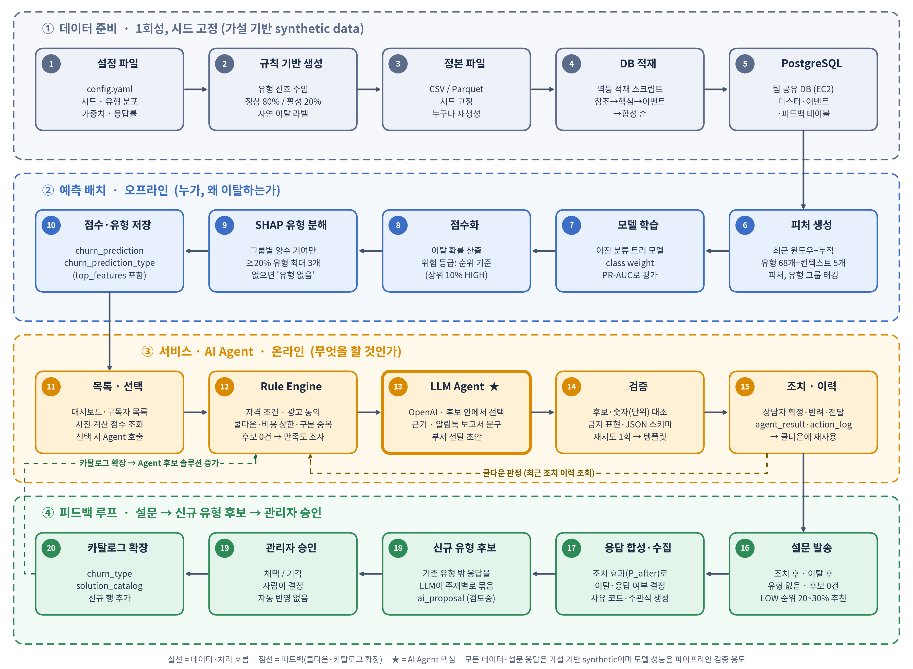

# 전체 파이프라인 설계 (v2 초안)

> LG전자 AX School Build2 · 구독 이탈 예측 & 유형별 맞춤 방지 AI Agent
> 작성 기준일: 2026-10-04 (2026-10-07 이탈 유형 10개 개정 반영, v2: 설문 피드백 루프 MVP 포함, 정상군 이탈 1%·절충안 분포·순위 기준 위험 등급 반영 / 2026-10-08 Agent 구현 반영: 부록·§3·§4·흐름도) / 관련 파일: `data_schema_design.md`, `schema_postgres.sql`, `churn_types_10.md`
> 모든 데이터는 **가설 기반 synthetic data**이며 실제 LG전자 데이터가 아닙니다. 모델 성능은 "파이프라인 검증" 용도로만 해석합니다.
> 표기: `[확정]` / `[제안]` / `[가정]` / `[팀 결정 필요]`

---

## 1. 한 장 요약

**오프라인(배치)에서 전 구독의 이탈 확률과 이탈 유형을 미리 계산해 DB에 저장하고, 온라인(화면)에서는 저장된 점수를 목록으로 보여 주다가 구독자를 선택했을 때만 LLM Agent를 호출해 유형별 솔루션과 안내 문구를 만든다. 조치 버튼은 `action_log`에 이력만 남기는 시뮬레이션이다. 조치 후·이탈 후·유형 없음 구독에는 설문을 보내고(시뮬레이션), 기존 유형에 맞지 않는 응답은 신규 유형 후보로 묶어 관리자가 승인하면 유형·솔루션 카탈로그가 확장된다.**

설계 원칙은 여섯 가지입니다.

1. **계산 분리**: 무거운 계산(피처·ML·SHAP)은 배치로 한 번에, LLM은 선택된 1건에만 호출 `[확정]`
   - 쉽게 말하면: 성적표는 시험 직후 한꺼번에 계산해 두고, 학부모가 보러 오면 꺼내 보여 주는 방식입니다. 목록 화면은 미리 계산된 점수만 읽고, 비용이 드는 LLM은 구독자 1명을 눌렀을 때만 부릅니다.
2. **역할 분리**: ML은 "누가·왜", Rule Engine은 "무엇을 해도 되나", LLM은 "어떻게 말하나"만 담당. LLM은 `solution_catalog` 화이트리스트 안에서만 고른다 `[확정]`
   - 쉽게 말하면: 병원과 같습니다. 검사(ML)가 "누가 아프고 왜인지"를 알려 주고, 병원 규정(Rule Engine)이 "이 처방을 지금 해도 되는지"(쿨다운·비용 상한·중복 조치)를 정하고, 의사 설명(LLM)이 "어떻게 말할지"를 맡습니다. 카탈로그에 없는 혜택을 LLM이 지어내지 못하게 막는 장치가 화이트리스트입니다.
3. **누수 차단**: 학습·추론 입력에는 `synth_*` 테이블을 쓰지 않는다. `subscription.status`는 스냅샷에서 전부 '활성'
   - 쉽게 말하면: 시험 볼 때 답안지를 미리 보여 주지 않는 것입니다. `synth_*`(이탈 정답을 만들어 낸 숨은 값)는 검증용으로만 쓰고 모델 입력에서는 뺍니다. 스냅샷에서 모두 '활성'이므로 "이미 해지됨"이 힌트로 새지 않습니다. 이걸 막지 않으면 점수만 높고 실제로는 쓸모없는 모델이 됩니다.
4. **재현성**: 데이터는 시드 고정 생성 → CSV/Parquet 정본 → 멱등 적재. 기준일(as_of)은 설정값
   - 쉽게 말하면: 레시피와 정확한 계량입니다. 시드를 고정하면 누가 언제 돌려도 같은 30,000명이 나오고, CSV/Parquet이 원본이라 DB가 망가져도 다시 만들 수 있습니다. 멱등 적재는 엘리베이터 버튼처럼 여러 번 눌러도 결과가 같다는 뜻이고, 기준일은 설정값이라 "오늘"이 바뀌어도 코드를 고치지 않습니다.
5. **단계적 구현**: Agent 코어를 먼저 mock ML 입력으로 만들고, 실제 모델·DB·화면을 붙이고, AWS 배포는 마지막 `[확정]`
   - 쉽게 말하면: 집 짓기와 같습니다. 뼈대(Agent 코어, 임시 ML 점수)를 먼저 세우고 실제 모델·DB·화면을 얹은 뒤 마지막에 AWS로 이사합니다. 배포가 꼬여도 로컬 시연으로 대체할 수 있습니다.
6. **사람 승인**: 설문에서 발굴한 신규 유형·솔루션은 자동 반영하지 않고 관리자 승인 후에만 카탈로그에 추가 `[확정]`
   - 쉽게 말하면: 신입이 제안한 새 정책을 팀장이 승인해야 시행하는 것과 같습니다. 설문에서 찾은 새 유형은 `ai_proposal`에 "검토중 → 채택/기각"으로 쌓이고, 관리자가 승인한 것만 실제 유형·솔루션이 됩니다.

한 줄로 줄이면: 비용(1)·안전(2)·정직한 평가(3)·같은 결과(4)·일정(5)·통제(6)를 지키기 위한 원칙입니다.

---

## 2. 전체 흐름도



번호 순서대로 ①(데이터 준비) → ②(예측 배치) → ③(서비스·AI Agent) → ④(피드백 루프)로 흐르고, 점선은 쿨다운 판정과 카탈로그 확장 피드백입니다. 상세 흐름도 소스는 `overall_pipeline.mmd`.

---

## 3. 단계별 명세

| # | 단계 | 입력 | 처리 | 출력 | 담당 모듈 |
|---|---|---|---|---|---|
| 1 | 더미 데이터 생성 | `config.yaml` 설정(시드·N·as_of, 제품군 비중·요금·계약기간·점검 주기, 정상/활성 비율, 유형 개수 분포(최대 3개), 유형별 가중치·강도, 라벨식 파라미터). 전체 목록은 `data_schema_design.md` §6 | 구독 속성 → 유형 활성화(정상 80%/활성 20%) → 신호 주입 → 자연 이탈 라벨. 조치·설문은 **여기서 만들지 않음**(모델·Agent 결과가 필요) | CSV/Parquet 14개 | `datagen/` |
| 2 | DB 적재 | CSV/Parquet | DDL 실행 후 참조→핵심→이벤트→합성 순으로 적재(멱등) | 채워진 PostgreSQL | `db/load.py` |
| 3 | 피처 계산 | 핵심·이벤트 테이블, as_of | 기간별 집계·추세·임박도 계산, 피처마다 유형 그룹 태깅 | 피처 행렬(구독 × ~45), 메모리 또는 Parquet | `features/build_features.py` |
| 4 | 모델 학습 | 피처 행렬, `synth_churn_label` | 구독 단위 층화 분할 학습, 확률 보정 | 모델 파일, 지표 | `model/train.py` |
| 5 | 점수화 + SHAP | 학습된 모델, 전체 피처 | 확률 산출 → SHAP → 유형 그룹별 기여 비중 → 양수 그룹 중 임계 이상 유형 채택(최대 3개, 없으면 유형 없음) | `churn_prediction`, `churn_prediction_type` | `model/score.py` |
| 6 | 목록·대시보드 | `churn_prediction*` | 위험 등급·유형·제품군 필터, 정렬 | 화면 | Streamlit + `GET` API |
| 7 | Agent 호출 | 선택된 구독의 예측 결과·근거 피처·최근 이력(DB에서 조립, `SqlSource`) | Rule Engine → LLM → 검증기·폴백 | 유형별 솔루션 + 근거 + 알림톡 보고서 형식 문구 + 부서 전달 초안(JSON), `agent_result` 저장 | `churn_agent/agent/`, `POST /agent/run` |
| 8 | 조치 시뮬레이션 | Agent 결과 중 상담자가 확정·반려한 항목, 부서 전달 | `action_log`에 조치완료·반려 기록(제안 단계는 `agent_result`에 저장) | `action_log` | `POST /agent/decision`, `/agent/forward` |
| 9 | 설문 발송 · 응답 합성 | 확정된 조치(`action_log`), 유형 없음 MID+, 점수·유형 | 설문 종류 3가지 발송(시뮬레이션) → **응답 합성기**가 조치 효과(`P_after`)로 이탈·응답 여부를 정하고 사유 코드·주관식을 생성 | `survey_send`, `survey_response` | `feedback/survey.py`, `feedback/simulator.py` + API |
| 10 | 신규 유형 후보 생성 | 사유 코드가 '기타'이거나 기존 유형에 안 맞는 응답 | LLM이 주제별로 묶고 후보명·요약·응답 수·비중·예시·솔루션 초안 작성 | `ai_proposal`(상태: 검토중) | `feedback/candidates.py` |
| 11 | 관리자 승인 | 후보 목록 | 채택/기각 + 사유 기록. 채택 시 `churn_type`·`solution_catalog` 행 추가 | 카탈로그 확장 | 관리자 화면 + `POST` API |
| 12 | 검증 | 위 전 단계 산출물, `synth_truth_type`, `synth_truth_topic` | 지표 계산·규칙 위반율·후보 복원율 점검 | 검증 리포트 | `eval/` |

### 3.1 모델링 상세 `[제안]` (2026-10-04 시뮬레이션 반영: 모델·위험 등급·유형 산출 확정)

- **모델**: 이진 분류 트리 모델 **XGBoost로 확정** `[확정]`(2026-10-04, 시뮬레이션에서 LightGBM과 PR-AUC 0.420 vs 0.416으로 동률, SHAP TreeExplainer 호환·설정 안정성 고려). LightGBM은 교체 후보입니다. LightGBM을 쓸 경우 조기 종료 지표를 명시(`first_metric_only`)하지 않으면 3번째 트리에서 학습이 멈추는 함정이 있습니다.
- **분할**: 데이터가 기준일(as_of, 설정값) 단일 시점 스냅샷(시계열 없음)이라 시간 분할이 불가능합니다. 피처는 기준일까지의 정보만 쓰고, 라벨은 기준일 이후 30일 내 이탈 여부입니다. 구독 단위 층화 분할(학습/검증/테스트)을 쓰고, 고객당 구독이 1개라 고객 단위 누수는 없습니다. 이 한계를 발표 자료에 명시합니다.
- **평가 지표**: 이탈률이 약 8%라 정확도는 메인 지표로 쓰지 않습니다 `[확정]`. 메인 PR-AUC, 보조 Recall/Precision@상위 N%, 학습 시 class weight, 제품군 비율 유지 층화 분할, 제품군별 성능 확인. `[제안]`
- **확률 보정·위험 등급**: 합성 라벨이 양극화되고 class weight 모델의 확률은 부풀려져서, 고정 컷오프(0.7/0.4)는 HIGH·MID가 각각 0.8%·3%(가중 없음)이거나 확률이 실제와 어긋납니다. 위험 등급은 **순위 기준(상위 10% HIGH, 다음 10% MID, 나머지 LOW) 확정** `[확정]`. 시뮬레이션: HIGH 이탈률 41%·포착 58%, MID 13%·18%, LOW 2%. 확률값은 "순위 점수"로만 설명합니다.
- **유형 산출(방법 B, SHAP 확정)** `[확정]`: 피처를 10개 유형 그룹(T01~T10, 68개 피처)에 귀속 → 구독별 SHAP을 그룹별로 합산(그룹 내 순합) → 양수 그룹만 남겨 비중 계산 → **비중 ≥ 20% 그리고 그룹 SHAP ≥ 0.5(로그오즈)** 인 유형 채택, 최대 3개, 기여도 순위. 비중만 쓰면 비중 합이 100%라 "유형 없음"이 거의 생기지 않아(정상군 0%) 절대 기준을 함께 둡니다(이전 11유형 시뮬레이션: 정상군 22%·활성군 3%가 유형 없음, 유형 복원 정밀도 95%·재현율 64% — **10유형으로 재검증 대기**, 특히 T05↔T07 혼동을 따로 확인). 0.5·20%는 합성 데이터 기준 `[가정]`이라 구현 후 재확인. 채택 유형이 없으면 "유형 없음"(MID 이상이면 만족도 조사). 컨텍스트 피처는 기여 계산에서 제외합니다.
- **대안(방법 A)**: SHAP이 불안정하면 유형별 신호 점수에 가중치를 부여해 수동 계산합니다. 폴백으로만 둡니다.
- **성능 해석**: 신호를 직접 심은 합성 데이터이므로 높은 AUC는 "파이프라인이 동작한다"는 증거일 뿐입니다. 유형 복원 검증도 순환적입니다.

### 3.2 Agent 호출 흐름 상세 (자세한 설계는 다음 문서) — 2026-10-06 결정 반영

1. 입력 조립: 구독 속성, 상위 유형(1~3개)과 `top_features`, 최근 문의·방문 요약(**규칙으로 만든 집계 숫자**, LLM이 원본 로그를 요약하지 않음), `action_log` 최근 이력
2. **Rule Engine** (코드로 결정적으로 동작, 수치는 `config.yaml`): 유형별 후보 솔루션을 카탈로그에서 뽑고 쿨다운 대상 제외 → 같은 구분 중복 제거 → 오퍼 비용 합계 상한 적용 → 동시 조치 수 상한. 시작값 `[제안]`(돌려 보고 조정):

   | 항목 | 시작값 |
   |---|---|
   | 쿨다운 | 같은 솔루션 14일(같은 구분 쿨다운은 삭제) |
   | 같은 구분 중복 제거 | 구분당 1개, 유형 기여도가 높은 쪽을 남김 |
   | 오퍼 비용 상한 | 1회 접촉당 합계가 해당 구독 월 요금 1개월분 이내(비율로 시작. 솔루션 38건 확정 후 `offer_cost`가 있는 솔루션은 3건뿐이라 상한은 안전장치 역할, `agent_design.md` §4.7) |
   | 동시 조치 수 | 최대 2개 |

3. **LLM** `[확정]`: Rule Engine이 남긴 후보 **중에서 선택·정렬**하고, 선택 근거 한 줄과 유형별 근거 문장·안내 문구를 작성(월 요금만 강조 금지, 총 비용·위약금 병기). 선택 근거는 화면에 보여 준다.
4. **검증기**: LLM이 고른 솔루션이 Rule Engine 후보 안에 있는지, 카탈로그에 없는 솔루션, 금지 표현, 입출력 JSON 스키마 위반, 근거 피처 값과 문장의 불일치를 확인. 실패 시 재시도 1회 후 템플릿 문구로 대체(시연 중 LLM 실패에도 화면이 비지 않게)
5. 결과는 화면에 표시되고, 사용자가 **확정/반려**만 한다(문구 편집은 MVP 제외) `[확정]`. 확정하면 `action_log`에 기록되고 이 기록이 다음 호출의 쿨다운 판단 근거가 된다.

**화면 구분과 설문 발송** `[제안]` (솔루션 38건 확정, 구분 4종 + 채널 4종은 `solution_catalog_design.md`)

- HIGH·MID: 유형별 솔루션 제안. 유형 없음이면 만족도 조사 경로(3.1). LOW: 기본은 "해당 없음", 필요하면 만족도 조사 대상.
- **설문 발송은 위험 등급과 무관하게 모든 구독에 대해 수동 발송 가능**(발송 버튼). 자동 추천 대상은 3.3의 발송 조건을 따른다. **LOW 중 위험 순위 상위 구간(전체 순위 20~30%, 약 3,000명)도 자동 추천 대상** `[확정]`(2026-10-06, 범위 값은 `config.yaml`에서 조정 가능). 나머지 LOW(순위 30% 밖)는 "해당 없음". 근거: 시뮬레이션에서 이탈자의 약 23%가 LOW에 남아 사유 파악 가치가 있음.
- 만족도 조사 항목은 팀에서 정해 전달 예정 → `solution_catalog` 반영.

**시연 사례와 초기 이력 시드** `[확정]`: 유형 1·2·3개, 유형 없음 사례는 구독 3만 명에서 자연스럽게 존재하므로 모델·점수화 후 조건 조회로 고른다. 쿨다운으로 후보가 줄어드는 사례를 보이려면 `action_log`에 과거 조치가 필요하므로 **초기 이력 시드 배치를 실행해 시연 데이터에 포함**한다(3.3의 (b)).

### 3.3 피드백 루프 상세 (설문 → 신규 유형 후보 → 관리자 승인) `[제안]`

**설문 종류와 발송 조건**

| 종류 | 대상 | 목적 |
|---|---|---|
| 조치 후 설문 (`post_action`) | `action_log`에서 조치가 확정된 구독 | 솔루션 만족도·문제 해결 여부 |
| 이탈 후 설문 (`post_churn`) | 조치 후에도 해지 접수한 구독(조치 효과를 거쳐 이탈이 남은 경우) | 이탈 사유 파악, 신규 유형 후보의 주재료 |
| 유형 없음 만족도 (`no_type`) | 유형 없음 + 위험 등급 MID 이상 | 불만 숨은 이유 탐색 |
| 후보 0건 대체 (`no_candidate`) | 유형은 있으나 조건에 맞는 후보가 0건(자격·쿨다운·광고 미동의)이라 만족도 조사로 대체된 구독 (2026-10-08 추가) | 왜 맞는 조치가 없었는지 확인 |
| 설문 추천 (`survey_only`) | LOW 중 위험 순위 20~30% 구간(LLM 없이 템플릿) | 잠재 불만 파악. 나머지 LOW는 조치 없음 |

**응답 합성기 — 실제 발송이 불가능하므로 설문 단계에서 합성** (데이터 준비 단계가 아니라 모델·Agent 이후에 실행)

합성은 점수·유형(②)과 조치(③)가 나온 뒤에야 가능합니다. 어떤 구독이 MID 이상인지, 어떤 솔루션이 나갔는지에 따라 효과와 응답이 달라지기 때문입니다.

1. 조치 대상(MID 이상)에 솔루션을 보낸 구독의 이탈 확률은 `P_after = P_before × (1 − r)`, `r`은 유형·솔루션 적합도(정확 대응 0.35~0.55 / 부분 0.10~0.25 / 불일치 0~0.05), 복합 유형은 해결한 유형의 기여 비중만큼만 감소, 상한 0.7 `[가정]`.
2. 학습 라벨(`synth_churn_label`)은 데이터 준비 단계의 **자연 이탈 기준 그대로** 두고, 조치 후 결과는 별도 컬럼·테이블에 둡니다(모델이 조치 효과를 위험 신호로 학습하지 않게).
3. 설문 응답: 응답 여부(이탈자 25~35%, 잔류자 15~20% `[가정]`) → 사유 코드·만족도(자기 유형과 맞는 사유 60%, 다른 기존 유형 10%, 숨은 신규 주제 20%, 기타 10% `[가정]`) → 주관식 문장(LLM 또는 주제별 문장 풀 샘플링).
4. 숨은 신규 주제 2~3개를 심어 두고(`synth_truth_topic`, 검증 전용·학습 입력 금지), 후보 생성이 이를 복원하는지 확인합니다.
5. 실행 방식 두 가지 `[제안]`: (a) **시연 중**: "설문 발송" 버튼을 누르면 합성기가 해당 구독의 응답을 즉시 생성(문장 풀 기반이라 LLM 호출 불필요). (b) **시연 전 초기 이력 시드**: MID 이상 구독에 Agent 규칙대로 조치를 낸 것으로 보고 일괄 합성해 두면, 후보 화면이 처음부터 비어 있지 않습니다.

**후보 생성과 승인**

- 후보 생성은 응답을 주제별로 묶는 **군집화·요약 작업**입니다. 이탈 예측 모델을 다시 학습시키는 방식이 아닙니다.
- 후보에는 후보명, 요약, 응답 건수·비중, 예시 응답, 솔루션 초안이 포함되고 상태는 `ai_proposal.status`의 검토중 → 채택 / 기각으로 관리합니다.
- 채택되면 `churn_type`(신규 유형)과 `solution_catalog`(신규 솔루션)에 행이 추가됩니다. 이후 신규 유형을 예측에 쓰려면 피처·모델 재학습이 필요하므로, MVP에서는 **"카탈로그에 등록되어 Agent 근거·솔루션 후보로 사용 가능"** 까지만 보여 줍니다. `[제안]`
- 발표 표현: "응답은 가설 기반 synthetic이며, 응답이 쌓이면 신규 유형 후보를 제안하고 사람이 승인하는 메커니즘이 동작함을 검증했습니다."

**MVP 이후 후보군**: 처치/대조군 분리(`assignment_group`)와 효과 측정 화면, 신규 유형 승인 후 모델 재학습 자동화.

---

## 4. 서비스 API 초안 (FastAPI) `[제안]`

| 메서드 | 경로 | 용도 | 주 사용 테이블 |
|---|---|---|---|
| GET | `/dashboard/summary` | 위험 등급 분포, 유형 분포, 제품군별 위험률 | churn_prediction, churn_prediction_type, subscription |
| GET | `/subscriptions` | 목록(필터: 위험 등급·유형·제품군, 정렬: 확률·만료 임박) | churn_prediction, subscription, customer |
| GET | `/subscriptions/{id}` | 상세(속성·점수·유형·근거 피처·최근 이력) | 위 + care_visit, voc_contact, action_log |
| POST | `/subscriptions/{id}/agent` | Agent 실행(솔루션·문구 생성, 저장 안 함) | churn_prediction_type, solution_catalog, action_log |
| POST | `/actions` | 조치 확정(시뮬레이션 기록) | action_log |
| GET | `/actions` | 조치 이력 목록 | action_log |
| POST | `/actions/{id}/survey` | 설문 발송(시뮬레이션) 및 사전 생성 응답 도착 처리 | survey_send, survey_response |
| GET | `/surveys` | 설문·응답 목록, 사유 분포 | survey_send, survey_response |
| GET | `/surveys/summary` | 설문 집계(관리자 EDA 화면용: 불편·조치 효과·원했던 해결 방법 등, 필터 적용) | survey_answer 집계 (`survey_simulator_design.md` §7) |
| GET | `/type-candidates` | 신규 유형 후보 목록(상태 필터) | ai_proposal |
| POST | `/type-candidates/{id}/decision` | 승인/반려, 승인 시 카탈로그 행 추가 | ai_proposal, churn_type, solution_catalog |

인증은 구현하지 않고 화면의 ID/선택값만 사용합니다. `[확정]`

**구현된 Agent API (2026-10-08, `churn_agent/agent/api.py`)**: 위 초안 중 Agent 부분은 아래로 구현했습니다. `/subscriptions/{id}/agent` → `POST /agent/run`, `/actions` → `POST /agent/decision`·`/agent/forward`로 읽습니다. 설문·후보·대시보드 API는 아직 구현 전입니다.

| 메서드 | 경로 | 용도 |
|---|---|---|
| GET | `/health` | LLM 상태(`mock`·`ready`·`unavailable`), 저장소, 예측 소스 |
| GET | `/catalog`, `/departments` | 솔루션 카탈로그, 협업 부서 마스터 |
| GET | `/subscriptions` | 예측 목록(위험 순위 순). 데모 모드는 시연 구독자 8명 |
| POST | `/agent/run` | 구독 1건 실행(요청 ID는 서버가 새로 만듦), 결과는 `agent_result`에 저장 |
| POST | `/agent/run-input` | 입력 JSON을 직접 넣어 실행(시험·시연용) |
| POST | `/agent/decision` | 고객 메시지·상담 안내 항목의 조치완료/반려(+메모) |
| POST | `/agent/forward` | 내부 전달 항목을 부서(복수)에 전달 |
| GET | `/subscriptions/{id}/actions` | 조치 이력(상태 라벨 포함) |

오류는 입력 오류 422, 없는 요청·구독 404, 이미 결정된 항목·중복 요청 409입니다.

---

## 5. 코드 구조 제안 `[제안]`

```
project/
  config.yaml            # as_of, N, 시드, 유형 분포·가중치, 위험 등급 기준, Rule Engine 수치, 설문 응답률·사유 비율
  datagen/               # 더미 데이터 생성기
  db/                    # schema_postgres.sql, load.py, session.py (SQLAlchemy)
  features/              # build_features.py, feature_groups.yaml (피처→유형 매핑)
  model/                 # train.py, score.py, shap_types.py
  agent/                 # rules.py, prompts/, llm_client.py, validator.py, schemas.py
  feedback/              # survey.py, simulator.py (응답 합성기), candidates.py (군집화·후보 생성), approve.py
  api/                   # FastAPI 라우터
  app/                   # Streamlit 화면 4개 (대시보드·구독자 목록·조치 이력·관리자 승인)
  eval/                  # 지표, 유형 복원, Agent 출력 검증
  tests/
```

`config.yaml`로 수치를 한곳에 모아 두면 `[팀 결정 필요]` 값이 바뀌어도 코드를 고치지 않습니다.

---

## 6. 구현 순서와 일정 `[제안]`

오늘(10/3) 기준, 발표 PDF 마감을 10/12 13:00으로 보고 역산한 대략적 순서입니다. 확정 일정은 팀 논의로 정합니다.

| 순서 | 작업 | 비고 |
|---|---|---|
| 1 | 스키마 확정(유형·솔루션 확정 후, 10/5 전후), 설정값 결정 | DB 종류·Rule Engine 수치 포함. 유형이 마스터 행이라 구조 변경은 적음 |
| 2 | Agent 코어(mock ML 입력으로) | 가장 먼저 독립 개발·시연 가능 |
| 3 | 더미 데이터 생성기 + 적재 | 코어와 병행 가능 |
| 4 | 피처 → 모델 → SHAP 유형 → 점수 저장 | mock을 실제 결과로 교체 |
| 5 | FastAPI + Streamlit 화면 연결 | 목록·상세·조치 이력 |
| 6 | 피드백 루프(응답 합성기·후보 군집화·관리자 승인 화면) | 합성기는 점수·조치 이후 실행, 초기 이력은 일괄 시드 |
| 7 | 검증·평가, 시연 시나리오 | 유형 복원, 규칙 위반율, 후보 복원율 |
| 8 | AWS 배포(~D7 목표) | 실패 시 로컬 데모로 대체 `[확정]` |
| 9 | 발표 자료 정리 | 10/12 13:00 마감 |

---

## 7. 위험 요소와 대응

| 위험 | 대응 |
|---|---|
| SHAP 유형 분해가 불안정 | 유형 그룹 단위로 집계하므로 개별 피처 변동은 완화. 그래도 불안정하면 방법 A(가중 점수)로 폴백 |
| 합성 데이터라 성능이 비현실적으로 높음 | 성능 수치를 발표에서 "파이프라인 검증"으로만 제시, 노이즈·라벨 오류율을 의도적으로 주입 |
| LLM이 카탈로그 밖 솔루션·금지 표현 생성 | 출력 스키마 강제 + 검증기 + 템플릿 폴백 |
| LLM 호출 지연·실패로 시연 중단 | 호출은 선택 시에만, 타임아웃 후 템플릿 문구, 시연용 결과 캐시 |
| AWS 배포 지연 | 로컬 실행을 기본 시연 환경으로 두고 배포는 마지막에 시도 |
| 설문 응답이 합성이라 신규 유형 "발굴"이 순환적 | 심어 둔 주제를 복원하는 메커니즘 검증으로만 표현, 응답에 합성 표시와 `synth_truth_topic`(검증 전용) |
| 신규 유형이 무분별하게 늘어남 | 후보는 제안 상태로만 생성, 관리자 승인 후에만 카탈로그 반영 |
| 팀원 간 DB 불일치 | 정본 CSV + 멱등 적재 스크립트로 누구든 재생성 가능 |

---

## 8. 팀 결정이 필요한 항목

1. DB 최종 확정(PostgreSQL EC2 공유 제안)
2. ~~모델 후보~~ → XGBoost 확정(2026-10-04). 평가 지표 우선순위(PR-AUC 메인)는 `[제안]`
3. Rule Engine 수치: 쿨다운 일수, 오퍼 비용 상한, 동시 조치 수 (유형 채택 임계값은 3.1에서 비중 20%+SHAP 0.5로 제안)
4. LLM 모델·호출 방식(사용 가능한 API 확인 필요)과 비용 한도
5. ~~위험 등급 기준~~ → 순위 기준(상위 10% HIGH / 다음 10% MID) 확정(2026-10-04)
6. 일정 확정(위 6번 표는 제안)
7. 설문: 종류 3가지·발송 조건·응답률·사유 비율, 숨은 신규 주제 2~3개의 내용
8. 유형 없음 처리: pseudo-type 행·`S-NT-A`·'의견수집' 구분은 시드·DDL에 반영함(2026-10-07), 엑셀 밖 항목이라 유지 여부만 팀 확인
9. 조치 효과 감소율 `r`(적합도별)과 상한
10. 신규 유형 승인 후 반영 범위(카탈로그 등록까지 vs 모델 재학습)

## 9. 다음 문서

**AI 에이전트 파이프라인 설계**: 입출력 JSON 계약(다중 유형), Rule Engine 의사코드, 프롬프트 구조, 검증·폴백, 테스트 케이스


---

## 부록. 2026-10-07 설계 (6) 이후 바뀐 점 (이 문서 본문보다 우선)

- Rule Engine은 v3(`priority` 정렬 + `eligibility`/`facts` 판정). 후보가 0건이면 만족도 조사(`S-NT-A`)로 대체. (`agent_design.md` §4.8)
- 조치 3종: 고객 메시지(알림톡·친구톡), 내부 전달, 상담·앱. 같은 채널·같은 광고 여부의 고객 메시지는 한 통으로 합쳐 `messages[]`로 제공하고, 광고성과 정보성은 섞지 않음. 내부 전달은 "협업 부서 전달" 화면에서 요청 조치+보조 조치를 한 장으로 묶어 부서를 복수 선택해 전달. 전달·발송 시점부터 14일 쿨다운. (`agent_code_design.md` §4)
- Agent 결과는 `agent_result`에 저장(재시작·감사·프롬프트 평가용). 설문은 `survey_send`/`survey_response`/`survey_answer`(long 형식), AI 제안은 `ai_proposal`. `churn_type_candidate`는 `ai_proposal`로 대체. DB 외래키는 두지 않고 `check_integrity.sql`로 검사. (`data_schema_design.md`)
- LLM은 OpenAI API(키는 환경변수 `OPENAI_API_KEY`), 출력은 JSON Schema(Structured Outputs) + 검증기 v3. 모델명은 미정. 이 문서에 나온 n8n·Streamlit 직접 호출 표현은 코드 구조 문서의 REST API(`/agent/run`, `/agent/decision`, `/agent/forward`)로 읽을 것.
- (2026-10-08) 고객 메시지는 알림톡 보고서 형식(제목 + 첫 문장 + ▶ 항목 + 마무리, 400자). ▶ 값은 고객 공개 값(`message_facts`)만 쓰고, 문의 횟수 같은 내부 분석값은 LLM에 보내지 않음. (`agent_prompt_design.md`)
- (2026-10-08) DB → Agent 연결: `SqlSource`가 예측·구독·고객·방문·문의·사용·결제 테이블에서 입력과 자격 판정 값(`facts`)을 조립. 샘플 7건으로 종단 시험. 광고 수신 동의 값이 없으면 미동의, '사건' 조건 값이 없으면 후보 제외. (`agent_code_design.md` §5)
